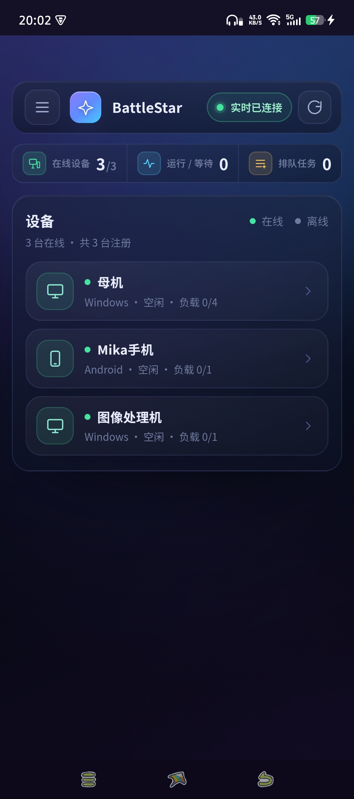
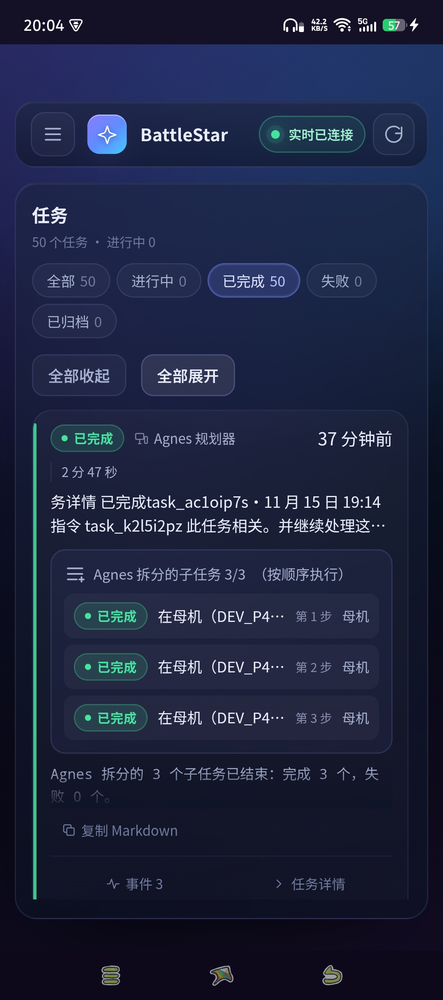
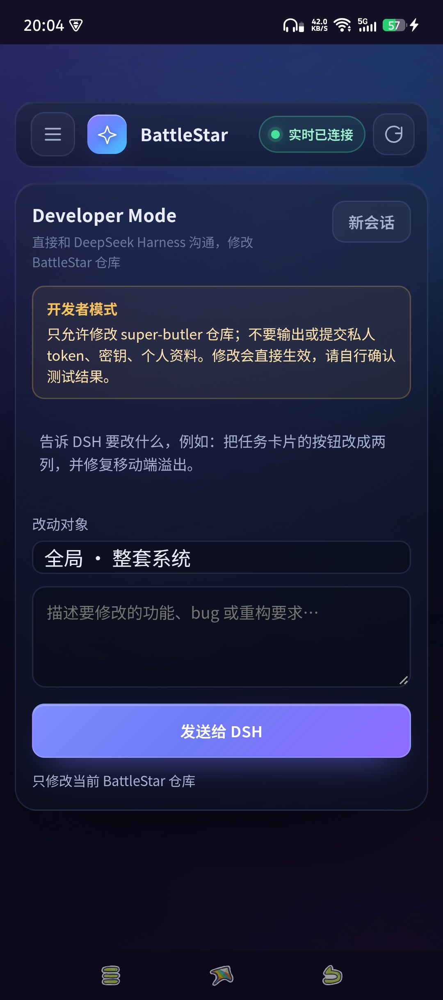
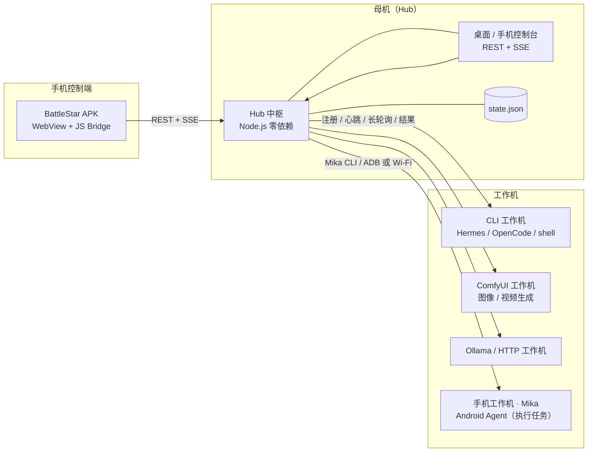

# BattleStar · 多设备 AI 管家

> 对外品牌、Hub `health.name`、Web 控制台、DSH 插件面板和 APK 显示名均为 **BattleStar**。
> 为了兼容已有设备令牌、插件安装和启动项，目录名、`@local/dsh-super-butler` 包名、`/super-butler/api/*` 路由和 `~/.super-butler` 状态目录保留旧标识符。

> 把家里多台跑着不同 AI 的设备，接进同一个「管家」：设备申报能力、管家按能力派活、手机随时看状态下指令。
> A private, multi-device AI butler for DeepSeek Harness: capability-aware routing across your own machines, phones, ComfyUI and CLI agents.

[](LICENSE)
[](package.json)
[](docs/DSH-PLUGIN.md)
[](dist/BattleStar-0.1.5.apk)

一个可私有部署的**多设备 AI 编排中枢**：

- 🧠 **能力申报**：每台设备接入时申报自己的 `models`、`profiles`、`gateways`、`skills`、资源与并发上限；
- 🟢 **在线检测**：10s 心跳 + 30s TTL，离线自动重派任务，恢复后自动上线；
- 🎯 **能力路由**：按模型 / 技能 / profile / gateway / 标签匹配，结合负载与新鲜度评分，并解释「为什么选它」；在此基础上再做**派发亲和**——显式设备 > 任务原主机（重试/跟进）> 同线程上次主机 > 项目上次成功设备 > 母机，首选主机离线或并发满时排队等待，避免把缺少项目上下文的主机接走导致失败；设备成功执行过某项目后会**自动获得项目名与项目标签别名**（`autoTags`，无需手工给设备加标签），大脑在任务里写的项目标签也会被登记为该项目的别名，不会因无人声明标签而永久排队；显式钉住的设备只缺标签时按能力放行，缺模型/技能等硬能力仍排除；
- 📋 **任务闭环**：`queued → assigned → running → completed`，支持进度、超时、取消、重试、改派；APK/网页可对失败/超时任务手动 **「标记成功」**；
- 👀 **执行过程可见**：本机 CLI（Hermes）任务运行时会实时上报「正在执行：工具 / 子任务 / 执行步骤」，任务卡片与事件时间线显示最新步骤，不再只显示「进行中」直到完成（依赖 Hermes `--format stream-json`，旧版自动回退粗粒度进度）；
- 🗂️ **Hermes 项目归属**：本机 Hermes 任务默认以 `--source cli` 记录会话（可在 Hermes 桌面/TUI 会话列表看到），并按「任务项目 > 设备默认项目 > 设备名」归入 Hermes 项目；首次使用时自动在对应 profile 的 `projects.db` 创建项目（目录 `<workdir>/projects/<slug>`；也可给绝对路径），控制台指令框可填「项目（可选）」；
- 🧭 **计划子任务上下文贯通**：Agnes 拆分的子任务会携带主任务 id / 主任务目标 / 计划步骤与兄弟子任务，设备端把它们拼进交给 Hermes 的 prompt，子任务里的“这里/该项目”不再失去参照；每个子任务按 `taskId` 隔离 Hermes 会话，避免同父任务的子任务互相污染；ComfyUI 工作机的 `promptPrefix` 改为条件式，日志/代码/打包等非生成类任务不再被强制调用 ComfyUI；
- 🧩 **长任务拆分**：长指令 / 长超时任务先由母机 Agnes AI 拆成可独立路由的子任务，父任务下可展开查看每个子任务；支持归档、取消归档、删除任务；
  - 默认 `instruction ≥ 800 字符` 或 `timeoutSec ≥ 900` 自动拆分；也可在 API 传 `split: true` 强制拆分；
  - 拆分时规划器同时判断并行/串行与依赖：可并行的子任务同时派发，有依赖的等前序完成才派发；前序失败/超时/取消时暂停并显示「卡点」，等你重试失败子任务或取消计划后再自动继续（可用 `blockerPolicy` 改自动继续）；
  - 单并发设备（如 Mika 手机，`limits.maxConcurrentTasks=1`）按排队逐条执行；规划器会看到每台设备的并发上限，需要 Mika 的子任务超过 2 个时建议用 `dependsOn` 串行排队；
  - 拆分需要母机进程有 `AGNES_API_KEY` / `AGNES_MODEL`（插件启动 Hub 时自动注入；独立启动 Hub 时手动设置环境变量），失败会自动回退为普通任务；
- 🗑️ **任务回收站**：已结束的任务可移入回收站（按任务线程 + 计划子任务一起回收），常规任务列表、统计与大脑思考自动忽略它们；控制台任务筛选新增「垃圾桶」视图，可一键恢复或彻底删除，失败视图支持「回收全部失败任务」；彻底删除会清理长期目标引用与对应执行记录；
- 🧵 **任务线程**：完成/失败的任务可以「继续此任务」，新任务自动带上一步指令、输出和错误作为上下文；APK/网页/插件按线程显示每一步；Hermes CLI 任务会尽量复用同一会话（`--resume`），上下文也会随任务传给其他执行器；
- 💬 **等待回答**：Mika 在手机上需要用户补充信息时，任务进入「等待回答」而不是直接失败；APK/网页/插件任务卡片会显示问题并可直接回答，回答后 Mika 继续执行；
- 🛠️ **Developer Mode**：在 BattleStar 内新增「开发」Tab，通过 DSH Host 的 `sessionController` 直接对话 DeepSeek Harness 并按需求修改本仓库；仅本机/Hub 管理员可用，限制在 `super-butler` 仓库，提示 agent 不读取/提交私人密钥与个人信息；DSH 的回复按 Markdown 渲染（标题 / 列表 / 代码块 / GFM 表格），手机端阅读更舒适；
  - 改动对象可选：全局 · 整套系统、DSH 插件、APK、Localhost 界面（`hub/web/**`）；
- 📎 **任务附件**：手机/网页端可给小任务附带文件（最多 3 个，每个 ≤2 MB，总计 ≤4 MB）；设备会落盘到任务附件目录并让执行器直接读取；APK 内置原生文件选择器；
- 📱 **任务列表优化**：APK/手机端任务列表内部滚动，底部导航栏固定，不再需要先滚到底才能切页；任务页默认筛选「进行中」（可切换全部/已完成/失败/已归档）；卡片收起时仍显示「子任务 N/M」和恢复操作（重试失败子任务 / 继续任务），任务详情新增「子任务」「任务线程」区块，可一键重试失败子任务或从某一步继续；失败任务在列表顶部提示并可一键跳到「失败」筛选；
- 📊 **任务输出表格**：任务卡片、任务详情与任务记录中的 Markdown 表格按 GFM 渲染（列对齐、表头、斑马纹、横向滚动，手机窄屏自动转卡片式），任务输出还可一键切换「渲染 / 原文」；任务详情中过长的指令默认折叠（右上角「展开指令 / 收起指令」），且指令含 Markdown 时同样按可视化渲染并可切「渲染 / 原文」，把视觉重点留给输出结果；
- 🖥️ **多种工作机**：本机 CLI（Hermes / OpenCode / shell）、ComfyUI 图像生成、Ollama、HTTP 服务；
- 🩺 **执行卡死治理与可见进度**：本机 CLI 起步「正在执行本机 CLI」不再被 800ms 节流吞掉，OpenCode 的 JSONL 输出会增量转成「OpenCode：工具/输出/开始新一轮」步骤，执行期间每 15s 至少一次「执行中（已 Xs）」心跳；连续 5 分钟无真实进度（`cli.stallTimeoutMs` 可调，0 关闭）会被 watchdog 终止并回报 `stalled`，不再静默等满 15 分钟；CLI 超时取 `max(cli.timeoutMs, task.timeoutSec)`（最长 1 小时），Hub 即使收到 keepalive 也不会把任务续期超过 `max(30 分钟, timeoutSec×6)`；设备上报 stalled / 无进度 / 本机 CLI 硬上限类失败时，Hub 在尝试次数预算内自动重排一次并保留原主机（普通内容错误不自动重排）；任务详情新增执行器/后端/模型与「已运行」时长，超时失败会提示拆分任务或调大 `timeoutSec`；自主大脑会把「多仓库 / 发布 / 部署 / 迁移 / 全量验证」类工作拆成 2–3 个 15 分钟内可完成的任务；
- 📱 **手机工作机**：通过 [Mika](https://github.com/wangzan101/Mika) 指挥 Android 手机执行 App/网页任务；
- 📲 **手机控制端**：Android APK（WebView + 本地配置页）加载 `/m`，看设备、发指令、看任务；它只是控制端，不执行 AI 任务；任务进度/完成/失败可在 Android 通知栏以进度条和提醒显示；
- ⏰ **提醒（Reminders）**：控制台新增「提醒」Tab，可增删改查一次性 / 每天 / 每周提醒，并可选择**通知方式**（温和通知 / 闹钟）；提醒保存在 Hub 的 `state.json`，到点由 **Android APK 用原生通知**弹出（App 被杀死或手机重启后仍有效），浏览器只负责管理、不弹通知；
- 🔗 **智能关联目标**：任务可关联长期目标（`task.goalId` ↔ `goal.taskIds`），计划父任务关联后子任务自动继承目标上下文；目标详情列出关联任务与 `linkedStats`（运行 / 完成 / 失败 / 计划进度），任务结束按 `taskId` 去重回写目标检查；「继续此任务」与带 `goalId` 创建的任务自动登记到目标，也可用 `POST /api/goals/:id/link|unlink` 手动关联/取消关联；
- 📋 **复制目标 ID**：控制台目标卡片 / 详情提供一键复制目标 ID，方便直接拼 `curl` 或插件接口（如 `POST /api/goals/:id/check`、`/link`）；
- 🧠 **自主大脑（Brain）**：Hub 按间隔读取目标 / 任务 / 提案 / 设备快照，让模型按固定六步（目标 → 进度 → 更好的工作方式 → 要改进哪里 → 我能做什么 → 是否提醒主人）输出严格 JSON 决策，按白名单自动「重试失败任务 / 继续已结束任务 / 新建任务 / 关联任务到目标」；没活时按空闲次数指数退避、跳过模型调用省 token（有效间隔封顶 1800s），有活立即回到基准间隔；模型输出夹带 ```json 围栏、前后解释文字、尾随逗号或被输出上限截断时会先自动清洗/修复，仍解析失败则带修复提示重试一次，避免偶发格式问题让整轮思考作废；单轮输出上限默认 4000 tokens（`BRAIN_MAX_TOKENS` 可调 1000–8000），DeepSeek 网关自动启用 JSON 输出模式；`auto`（默认，单轮最多 2 个动作，置信度 <0.6 拒绝）与 `suggest`（只建议不执行）两种模式，决策历史保留 30 条并含六步结论与「需要主人」提醒（`ownerAsk`，可用 `POST /api/brain/owner-ask/choose` 点选选项、`POST /api/brain/owner-ask/reply {text}` 直接写一段回复，或 `PATCH /api/brain {ownerAskAck:true}` 回执；控制台「大脑」页与大脑抽屉常驻「直接告诉大脑」输入框，没有待决定问题时也能主动给方向，回答会回显并在下一轮思考中带上；**提问的选项可带 detail 细节**（每个选项做什么、大概多久、成功/失败会怎样，≤240 字），控制台按「按钮 + 说明」展示，细节缺失时显示「让大脑补充细节」按钮，提示词要求选项没有细节就先查清楚再问），可通过 `GET/PATCH /api/brain` 与 `POST /api/brain/think` 查看、调整和手动触发；**需要主人决定时会推送 Android 通知**：通知栏直接列出最多 3 个可点选项，点一下即把选择写回 Hub，下一轮思考按选择推进；没有选项时点通知打开 App 的决策卡片；**任务里提到的文件路径会先在 Hub 主机上实测存在性/同名候选位置（「路径核查」，`BRAIN_PATH_ROOTS` 可追加扫描根），并明确要求大脑不要拿文件路径、是否存在这类机器可查事实去问主人（应建自包含 create_task 让有文件的设备自查）；最近决策会带出已经问过的问题，避免反复问同一件事**；**缺少只有某台设备才知道的项目上下文时，可用 `consult_worker` 向「项目 ↔ 主机」映射里的设备提一个只读问题**（Hub 建咨询任务，回答写入下一轮的「咨询记录」，同一问题不再重复问）；**长期约定可用 `remember` 写入「管家记忆」**（最多 20 条、每轮注入、随 `state.json` 持久化）；
- 🧭 **管家心路（Journal）**：把管家思考与工作结果按天记入 `state.json` 的 `journal` 时间线（思考 / 工作 / 里程碑 / 每日总结），每天 `summaryTime`（默认 23:30）自动生成《每日总结》（今天实质推进 / 卡点 / 明天方向），模型不可用时自动降级为本地汇总；控制台「管家心路」页可按天回看并手动生成总结，也可用 `GET/PATCH /api/journal` 与 `POST /api/journal/summary` 管理；
- 🗣️ **头脑风暴（Brainstorm，对话大脑）**：控制台「头脑风暴」页可与管家大脑多轮对话，结合长期目标 / 任务 / 管家心路上下文给出结构化思路、方案与下一步；支持一次附上多个文本文件，或直接在消息里写 Hub 本机文件路径，Hub 会读取内容一起讨论（拒绝密钥/凭据与二进制文件）；首条消息自动命名会话（最多 30 个会话、每个 200 条消息），模型不可用时回复带错误但仍保存、可继续追问；可一键把某条大脑回复「转成任务」（`priority=6`、可同时关联长期目标），也可用 `GET /api/brainstorm`、`POST /api/brainstorm/chat|sessions|to-task`、`DELETE /api/brainstorm/sessions/:id` 管理；
- 🧬 **心智（Soul / Skill）**：给自主大脑一段稳定的「灵魂」（个性、价值观、语气、面对不确定与失败的态度，≤6000 字）和一份可迭代的「工作方法」（观察 → 抓主要矛盾 → 评估 → 小步执行 → 复盘 → 请示的步骤化流程，≤12000 字），每次思考都会注入提示词；编辑入口已迁到 **DSH 插件面板 → BattleStar → 心智 Tab**（Web 控制台不再显示），单卡/全部恢复默认，`GET/PATCH /api/mind` 管理，持久化在 `state.json` 的 `mind` 字段；
- 🧩 **DSH 插件**：在 DeepSeek Harness 侧边栏查看只读仪表盘（母机状态、在线设备、任务统计、最近任务），一键在浏览器打开完整控制台，内置 PC / 手机工作机接入教程，并在插件里保存私人 API 密钥；
- 🪶 **零依赖**：Hub / 设备代理 / 前端全部零 npm 依赖，Node.js 单进程即可跑；APK 约 0.12 MB。

概念参考 [dsh-superagent-prototype](https://github.com/deepseek-ai/dsh-superagent-prototype)（目标—授权—执行—回报），
手机控制台交互参考 [dsh-Go](https://github.com/ccch1mneyyy/dsh-Go)。许可证与完整 credits 见 [CREDITS.md](CREDITS.md)。

---

## 30 秒体验

```bash
git clone https://github.com/andrewngg/dsh-superagent-battlestar.git super-butler
cd super-butler
node scripts/demo.js
```

一条命令启动 Hub + 3 台差异化模拟设备（书房工作站 / 客厅媒体中心 / 手机 Pixel），自动派发 3 条示例任务，并打印：

```
桌面控制台  http://127.0.0.1:7394/?token=demo-admin-token
手机控制台  http://<本机内网IP>:7394/m?token=demo-admin-token
加入码      demo-join-code
```

浏览器打开桌面或手机控制台即可看到设备能力、任务进度与路由解释；`Ctrl+C` 全部退出。
接真实设备见下方「安装」或 [docs/INSTALL.md](docs/INSTALL.md)。

## 界面预览


*设备管理面板 — 母机 / 手机工作机 / 图像处理机，实时在线状态一目了然。*


*任务列表 — Agnes 规划器拆分的子任务执行闭环，可展开查看每一步详情。*


*Developer Mode — 通过 DeepSeek Harness 直接与代码仓库对话，按需求修改 BattleStar 系统。*

## 架构



详细设计见 [docs/ARCHITECTURE.md](docs/ARCHITECTURE.md)，接口契约见 [docs/PROTOCOL.md](docs/PROTOCOL.md)。

### 任务怎么被派到某台设备

```
一句话指令
  → 规范化 requirements（model / skills / profile / gateway / tags / deviceId）
  → 过滤：离线、禁用、满载、缺少能力（记录 excluded 原因）
  → 评分：100 - 20×负载率 + 显式设备 15 + 能力标签 5 + 心跳新鲜度
  → 下发 run_task 命令 → 设备 ack → running → progress → result
  → 无候选时排队；设备上线或能力变化时自动重试
```

每个任务保存 `route.candidates` 与 `route.excluded`，控制台与手机端直接展示，方便排查「为什么没派给我的设备」。

## 安装：母机 + 工作机

> **角色区分（容易混淆）**
> - **手机工作机（Mika）**：属于「工作机」，负责在 Android 手机上执行 App / 网页任务，由管家下发指令。
> - **BattleStar APK / 浏览器**：属于「控制端」，只用来查看设备、发指令、看进度，本身不执行 AI 任务。
> 两者可以是同一部手机上的两个不同应用/角色。

完整的逐步说明在 **[docs/INSTALL.md](docs/INSTALL.md)**，下面是总览。

### 母机（Hub）

要求：一台常开设备（NAS / 小主机 / 旧笔记本，Windows / Linux / macOS）+ Node.js ≥ 18 + 家庭内网。

```bash
git clone https://github.com/andrewngg/dsh-superagent-battlestar.git super-butler
cd super-butler
node hub/server.js --port 7317 --host 0.0.0.0 --data-dir hub/data
```

启动日志会打印：

```
管理员令牌  adm_...
加入码      join_...
手机控制台  http://<母机IP>:7317/m?token=adm_...
本机控制台  http://127.0.0.1:7317/?token=adm_...
```

- 令牌与加入码保存在 `hub/data/state.json`（已 gitignore），请备份，不要提交；
- 验证：`curl http://<母机IP>:7317/api/health`；
- 浏览器打开控制台即可；手机浏览器可打开 `/m?token=...` 或安装 APK；
- 开机自启（Windows 任务计划 / Linux systemd）见 [docs/INSTALL.md](docs/INSTALL.md#5-开机自启可选)；
- 可选安装 DSH 插件，在 Harness 里打开控制台（见下文）。

### 工作机（Worker）

每台工作机安装 Node.js ≥ 18，复制/克隆项目，选择执行器，用母机的加入码注册：

```bash
node device-agent/agent.js \
  --hub http://<母机IP>:7317 \
  --join-code <加入码> \
  --config device-agent/configs/<你的配置>.json \
  --state-dir device-agent/.state/<设备名>
```

按能力选择配置模板：

| 工作机类型 | 执行器 | 配置模板 | 说明 |
| --- | --- | --- | --- |
| **本机 AI CLI** | `cli` | [cli-machine.example.json](device-agent/configs/cli-machine.example.json) | Hermes / OpenCode / shell；代码、调研、办公等任务 |
| **ComfyUI** | `comfyui` | [comfyui-machine.example.json](device-agent/configs/comfyui-machine.example.json) | 文生图、图生图、放大、视频；见 [SECOND-MACHINE.md](docs/SECOND-MACHINE.md) |
| **手机工作机（Mika）** | `mika` | [phone-mika.example.json](device-agent/configs/phone-mika.example.json) | 手机运行 Mika，PC 上的 `mika` CLI 作为桥；见 [MIKA-PHONE.md](docs/MIKA-PHONE.md) |
| **Ollama / HTTP** | `ollama` / `http` | [config.example.json](device-agent/config.example.json) | 本地模型或已有 Agent 服务 |
| **演示** | `simulate` | — | 无需外部服务，用于联调 |

工作机上线后，母机控制台会显示设备名、在线状态、models / profiles / gateways / skills chips 与负载。
- 设备详情抽屉里可以给设备起**用途昵称**（≤40 字，保存在 Hub 的 `state.json`）：卡片、任务执行设备、路由结果都优先显示昵称；设备重新上报机器名不会覆盖昵称，清空昵称后回退显示机器名。昵称字段是后端新增功能，**升级代码后需要重启一次 Hub** 才会生效——旧版 Hub 上抽屉会提示「当前 Hub 还没加载昵称功能」并提供一键「重启 Hub」按钮。
- 工作机会自动补连：配置的 Hub IP 失效时，代理会扫描本机 IPv4 `/24` 网段的 `7317` 端口，发现 BattleStar Hub 后自动重连；跨 VLAN/不同网段请使用 DHCP 固定 IP 或主机名。
所有执行器都是可配置、可插拔的；设备主人决定允许执行什么。

### 让 AI 自动配置工作机（WORKER-SETUP）

如果工作机上有一个能执行命令的 AI Agent，把下面这段发给它，它就会读取参考文件并自动完成配置与注册：

```text
读取本仓库的 docs/WORKER-SETUP.md，把本机配置成BattleStar的「工作机」并自动注册到母机。
母机：http://<母机IP>:7317
加入码：<JOIN_CODE>
角色：cli（或 comfyui / mika / ollama / http）
设备名：<DEVICE_NAME>
可选管理员令牌（仅用于验证）：<ADMIN_TOKEN 或留空>
按文件里的步骤执行，完成后按第 7 节格式汇报。
```

参考文件：[docs/WORKER-SETUP.md](docs/WORKER-SETUP.md)

它只需要你提供：

| 信息 | 必填 | 说明 |
| --- | --- | --- |
| 母机 URL | ✅ | `http://<母机IP>:7317`，工作机必须能访问 |
| 加入码 | ✅ | 母机启动日志里的 `join_...` |
| 角色 / 执行器 | ✅ | `cli` / `comfyui` / `mika` / `ollama` / `http` |
| 管理员令牌 | 可选 | 仅用于自动验证设备是否上线、发测试任务 |
| 工作机自身 IP / 端口 | ❌ 不需要 | 工作机主动连母机，Hub 不会反向连接工作机 |

> 这不是「互相桥接」：注册、心跳、领任务都是工作机发起的出站请求（`POST /api/devices/register` → 心跳/长轮询）。
> 只有 Mika 桥需要本机连手机（ADB/Wi-Fi）、ComfyUI 需要本机连 `127.0.0.1:8188`，都与母机入站无关。

### 手机控制端（APK / 浏览器）

> 这里是**控制端**，不是工作机。手机工作机是 Mika，见上面的工作机表格与 [docs/MIKA-PHONE.md](docs/MIKA-PHONE.md)。
> APK 品牌名已改为 **BattleStar**（包名仍为 `com.superbutler.app`，可直接覆盖安装旧版）。

- 浏览器直接打开 `http://<母机IP>:7317/m?token=<管理员令牌>`，可添加到主屏幕；
- 或安装 [dist/BattleStar-0.1.5.apk](dist/BattleStar-0.1.5.apk)（Android 8+，测试签名；构建/安装见 [docs/APK.md](docs/APK.md)）。
- APK 首次打开会自动扫描同一 Wi-Fi 网段的 Hub（默认端口 7317），发现后只需填管理员令牌，不用记母机 IP；也可改端口手动扫描。
- 首次打开自动发现母机（或手动填 Hub 地址），再填管理员令牌，点「测试连接」→「进入管家」。
- 任务执行时通知栏显示**常驻进度条**，完成后推送完成/失败提醒；Android 13+ 首次启动需允许通知权限。
- APK「设置 → 手机通知（APK）」可开启**常驻通知**：有任务时显示任务进度，没有任务时显示 `X 台在线 · Y 台待命`。
- 「提醒」Tab 创建的提醒由 APK 原生 `AlarmManager` 在到点弹出系统通知（App 被杀死/手机重启后仍有效），每条提醒可选择温和通知或闹钟式提醒；浏览器可管理提醒但不会弹通知，详见下方「提醒（Reminders）」。
- **决策通知**：自主大脑需要主人拍板时，通知栏弹出「管家需要你决定」，直接带最多 3 个选项按钮（点选即回传 Hub，下一轮按选择推进）；没有选项时点通知会打开 App 并定位到「自主大脑」卡片，也可以在控制台点选。

### DSH 插件（可选，推荐）

`dsh-plugin/` 是一个 DeepSeek Harness bundle，安装后侧边栏出现「BattleStar」：

- 原生面板是**只读仪表盘**：母机状态（运行中/已停止、Hub 地址、是否由插件托管）、在线设备概览（用途昵称、状态、负载、最近心跳）、任务统计（在线设备 / 运行中 / 排队 / 已完成 / 失败 / 超时）与最近任务，每 5 秒自动刷新；
- 仪表盘的 **「重启 Hub」** 对插件托管和外部终端启动的 Hub 都可用：插件调用 Hub 自重启接口 `POST /api/system/restart`，进程原地 re-exec 并加载新代码（「停止 Hub」仍只对插件自己启动的进程生效）；
- 「在浏览器打开控制台」按钮通过插件路由 `GET /super-butler/api/dsh/open` 302 到 Hub 控制台并自动带上管理员令牌，任务下发、设备管理（含改用途昵称）与任务详情都在浏览器控制台完成；
- 工作机卡片直接显示**用途昵称**（昵称保存在 Hub，设备重报机器名不会覆盖），只读不提供修改入口；
- 「教程」页给出把 PC / 手机接成工作机的分步命令：Hub 地址与设备加入码按当前 Hub 自动填好，命令块可一键复制，覆盖 PC 代理、Mika 手机工作机、手机控制端与常见排错；
- 「设置」里统一保存 GitHub 账号/Token 与各模型 API Key，写入 **Harness credentials 服务**（不写项目文件、不回显）；
- 每个已配置 Token 旁有 **「测试 Token」** 按钮：GitHub 调 `/user`，DeepSeek/Agnes/豆包/OpenCode 调各自只读 `/models` 接口，返回可用/无效/无法判定与延迟；
- 「设置 → 开发工具」有 **Git Push** 按钮：点击后在母机项目仓库执行 `git push`，只推送**已经提交**的内容（不暂存、不改文件），面板显示仓库/分支/远端/上游与推送输出；分支还没有上游时自动改用 `git push --set-upstream <remote> <branch>`；路由为 `GET/POST /super-butler/api/dsh/git-push`，仅本机 loopback 可用；
- 桌面版 DSH 每次启动的 Web 端口可能变化：插件启动时会把当前地址同步给 Hub（写入 `<dataDir>/dsh-bridge.json` 并 `POST /api/dsh/bridge`），Hub 代理失败时也会自动换新地址重试，所以手机「开发页」不会再因为 DSH 换端口报 `DSH bridge 不可用：fetch failed`；
- 插件自动检测/启动 Hub，通过 `/super-butler/api/*` 同源代理，页面不接触管理员令牌；重定向路由只接受本机 loopback 调用。

安装方式：

```
plugin_manager(action: "install_bundle", target: "<abs>/super-butler/dsh-plugin")
```

`projectRoot` 可在插件配置里指向项目位置，或设置 `SUPER_BUTLER_PROJECT_ROOT`；详见 [docs/DSH-PLUGIN.md](docs/DSH-PLUGIN.md)。

## 目录结构

```
super-butler/
├─ hub/                    # 母机中枢（Node 零依赖）
│  ├─ server.js            # CLI 入口，打印令牌/加入码/手机 URL
│  ├─ lib/                 # 注册表、路由、任务、HTTP、SSE、持久化、静态服务
│  ├─ web/                 # 桌面 + 手机控制台（零构建）
│  └─ test/                # 257 个 Hub 用例
├─ device-agent/           # 工作机代理
│  ├─ agent.js             # 注册/心跳/长轮询/执行/回报
│  ├─ cli-worker.js        # 本机 CLI 执行器（Hermes / OpenCode / shell）
│  ├─ lib/                 # discovery / executors / hub-client / state ...
│  ├─ configs/             # 工作机配置模板（cli / comfyui / mika / examples）
│  └─ test/                # 90 个代理用例
├─ shared/                 # manifest 规范化 / 匹配 / 评分（Hub 与代理共用）
├─ dsh-plugin/             # DSH 插件：侧边栏控制台 + 私人密钥设置
├─ android/                # APK 工程 + 手工构建流水线
├─ dist/                   # 构建产物：BattleStar-0.1.5.apk、icon-512.png
├─ scripts/                # demo.js / smoke-test.js / simulate-devices.js
├─ docs/                   # INSTALL / WORKER-SETUP / PROTOCOL / ARCHITECTURE / DEPLOY / APK / SECOND-MACHINE / MIKA-PHONE / DSH-PLUGIN
├─ CREDITS.md              # 第三方来源、许可证、商标与 AGPL 合规说明
├─ LICENSE                 # MIT
└─ package.json            # npm scripts（无依赖）
```

## API 速览

```bash
# 健康检查
curl http://<母机IP>:7317/api/health

# 设备列表（管理员令牌）
curl -H "X-Butler-Token: <adminToken>" http://<母机IP>:7317/api/devices

# 发任务：需要 Word 技能，优先级 7
curl -X POST http://<母机IP>:7317/api/tasks \
  -H "X-Butler-Token: <adminToken>" -H "Content-Type: application/json" \
  -d '{"instruction":"把本周家庭开销整理成 Word 报告","requirements":{"skills":["office-docx"]},"priority":7}'

# 任务回收站：把已结束任务移入回收站 / 恢复 / 彻底删除（均需管理员令牌）
curl -X POST -H "X-Butler-Token: <adminToken>" http://<母机IP>:7317/api/tasks/<taskId>/trash
curl -X POST -H "X-Butler-Token: <adminToken>" http://<母机IP>:7317/api/tasks/<taskId>/restore
curl -X POST -H "X-Butler-Token: <adminToken>" http://<母机IP>:7317/api/tasks/<taskId>/purge
# 默认任务列表 / 统计不含回收站任务，加 includeTrashed=1 查看（控制台「垃圾桶」同源）
curl -H "X-Butler-Token: <adminToken>" "http://<母机IP>:7317/api/tasks?includeTrashed=1"

# 实时事件（SSE）
curl -N "http://<母机IP>:7317/api/events?token=<adminToken>"

# 整套系统自重启（先通知在线设备代理重启，再重启 Hub；运行中任务自动重新排队）
curl -X POST -H "X-Butler-Token: <adminToken>" http://<母机IP>:7317/api/system/restart

# 长期目标：每天 09:30 自动检查目标进度并给建议
curl -X POST http://<母机IP>:7317/api/goals \
  -H "X-Butler-Token: <adminToken>" -H "Content-Type: application/json" \
  -d '{"title":"持续跟进求职进展","description":"每周整理投递与面试结果","schedule":{"type":"daily","time":"09:30"}}'

# 立即跟进一次（创建一条关联 goalId 的普通任务）
curl -X POST -H "X-Butler-Token: <adminToken>" http://<母机IP>:7317/api/goals/<goalId>/check

# 目标详情（含关联任务 tasks 与统计 linkedStats） / 关联、取消关联任务
curl -H "X-Butler-Token: <adminToken>" http://<母机IP>:7317/api/goals/<goalId>
curl -X POST -H "X-Butler-Token: <adminToken>" -H "Content-Type: application/json" \
  -d '{"taskId":"<taskId>"}' http://<母机IP>:7317/api/goals/<goalId>/link
curl -X POST -H "X-Butler-Token: <adminToken>" -H "Content-Type: application/json" \
  -d '{"taskId":"<taskId>"}' http://<母机IP>:7317/api/goals/<goalId>/unlink

# 自主大脑：查看状态与决策历史 / 调整设置 / 立即思考一次
curl -H "X-Butler-Token: <adminToken>" "http://<母机IP>:7317/api/brain?decisions=10"
curl -X PATCH -H "X-Butler-Token: <adminToken>" -H "Content-Type: application/json" \
  -d '{"mode":"suggest","intervalSec":300}' http://<母机IP>:7317/api/brain
curl -X POST -H "X-Butler-Token: <adminToken>" http://<母机IP>:7317/api/brain/think

# 大脑提问选项：点选一个选项（手机通知/控制台按钮都调用它）
curl -X POST -H "X-Butler-Token: <adminToken>" -H "Content-Type: application/json" \
  -d '{"optionId":"o1"}' http://<母机IP>:7317/api/brain/owner-ask/choose

# 大脑自由回复：直接写一段话（如「选 B，先手动补投递」），下一轮思考会带上
curl -X POST -H "X-Butler-Token: <adminToken>" -H "Content-Type: application/json" \
  -d '{"text":"选 B，先手动补投递，同时重建自动投递任务"}' http://<母机IP>:7317/api/brain/owner-ask/reply

# 管家心路：查看日志与设置 / 生成今日总结
curl -H "X-Butler-Token: <adminToken>" "http://<母机IP>:7317/api/journal?days=10&entries=50"
curl -X PATCH -H "X-Butler-Token: <adminToken>" -H "Content-Type: application/json" \
  -d '{"enabled":true,"summaryTime":"22:30"}' http://<母机IP>:7317/api/journal
curl -X POST -H "X-Butler-Token: <adminToken>" -H "Content-Type: application/json" \
  -d '{"force":true}' http://<母机IP>:7317/api/journal/summary

# 头脑风暴：查看会话 / 多轮对话 / 把回复转成任务
curl -H "X-Butler-Token: <adminToken>" "http://<母机IP>:7317/api/brainstorm?messages=50"
curl -X POST -H "X-Butler-Token: <adminToken>" -H "Content-Type: application/json" \
  -d '{"message":"帮我把求职目标拆成本周行动"}' http://<母机IP>:7317/api/brainstorm/chat
curl -X POST -H "X-Butler-Token: <adminToken>" -H "Content-Type: application/json" \
  -d '{"sessionId":"<sessionId>","messageId":"<messageId>","goalId":"<goalId>"}' \
  http://<母机IP>:7317/api/brainstorm/to-task

# 心智：查看灵魂与工作方法 / 修改 / 恢复默认
curl -H "X-Butler-Token: <adminToken>" http://<母机IP>:7317/api/mind
curl -X PATCH -H "X-Butler-Token: <adminToken>" -H "Content-Type: application/json" \
  -d '{"soul":"冷静、具体、先算代价再动手。","skill":"先观察，再抓主要矛盾，然后做最小可逆动作。"}' \
  http://<母机IP>:7317/api/mind
curl -X PATCH -H "X-Butler-Token: <adminToken>" -H "Content-Type: application/json" \
  -d '{"resetSoul":true,"resetSkill":true}' http://<母机IP>:7317/api/mind

# 提醒：到点由手机 APK 弹系统通知（dueAt 为 epoch 毫秒，repeat 可为 none/daily/weekly，
# notifyStyle 可选 gentle（温和通知，默认）或 alarm（闹钟式，响亮提示 + 震动））
curl -X POST http://<母机IP>:7317/api/reminders \
  -H "X-Butler-Token: <adminToken>" -H "Content-Type: application/json" \
  -d '{"title":"吃药","note":"饭后","dueAt":1794186000000,"repeat":"daily","notifyStyle":"gentle"}'
```

控制台也有同款入口：**设置 → 系统维护 → 重启整套系统**。任务运行超时会在 `maxAttempts` 内自动重试，不需要人工点「重试」。

完整端点、数据结构、评分规则见 [docs/PROTOCOL.md](docs/PROTOCOL.md)。

## 测试与验收

```bash
# 单元测试：Hub 325 + 设备代理 111 + 共享协议 9（共 445）
node --test hub/test device-agent/test shared/test

# 受限沙箱（Node 测试运行器无法 spawn 子进程）时：
# 注意：Node 24 的 --test-isolation=none 不接受目录参数（会报 ERR_UNSUPPORTED_DIR_IMPORT），
# 需要显式列出测试文件（bash / PowerShell 会展开 *；cmd 需自行展开）：
node --test --test-isolation=none hub/test/*.test.js device-agent/test/*.test.js shared/test/*.test.js

# DSH 插件协议/渲染测试（44）
node --test dsh-plugin/test

# 端到端冒烟：Hub + 3 台真实代理进程 + 路由 + 离线/恢复
node scripts/smoke-test.js

# 一键 demo
node scripts/demo.js
```

**实测结果**

- `hub/test` 325/325、`device-agent/test` 111/111、`shared/test` 9/9（合计 445/445）；`dsh-plugin/test` 45 项（44 通过 + 1 项真实 `git push` 集成测试在受限沙箱下跳过，沙箱外应全绿）；
- 关键回归覆盖：队列治理（排队超时自动 failed 并写明原因、设备上线/腾槽时单次补派受 `redispatchBudget` 限制、启动恢复不一次性重派历史 queued、自主大脑同目标并发闸与去重升级（标点/空白归一化 + bigram Jaccard））、进度 keepalive 续期超时、超时自动重试（含关闭开关）、本机 CLI 卡死治理（worker 的 15s 心跳标记为 silent、不再刷新真实进度时间；无真实输出满 `stallTimeoutMs` 即 stalled 终止并触发自动重试；运行约束禁止在任务里起常驻服务）、系统自重启（设备通知 + Hub re-exec + 自重启后任务自动重新排队）、并发满载时重启/取消指令优先、**重复派发防护（设备忙碌时 ack 超时不重派并重投同一 command id、派发预算 guard、重复/旧 attempt 结果 200 ignored 收敛、设备收到即 ack、taskId 去重、队列上限与排队 keepalive）**、任务结果 attempt 归因（自动重试后旧 attempt 的超时/取消结果不会终结新 attempt）、派发亲和（显式 deviceId 硬锁 > 任务原主机 > 同线程上次主机 > 项目上次成功设备 > 母机；离线/并发满时排队等待而非改派；任务失败重试留在原主机；`settings.mainDeviceId` 指定与持久化；计划并行子任务不被线程亲和阻塞）、自动标签（设备成功执行项目后自动获得项目名与项目别名 `autoTags`、任务里的项目标签登记为项目别名、显式钉住设备只缺标签不阻塞、缺硬能力仍排除、`state.routing.projectTags` 持久化）、自主大脑路径核查（Hub 主机实测文件存在性/同名候选、任务项目与设备上下文、历史提问防重复、提示词禁止用路径等机器可查事实问主人）、自主大脑咨询 worker 与管家记忆（`consult_worker` 只读咨询任务钉到指定设备、回答回写「咨询记录」并注入下一轮、同设备咨询不重复；`remember` 写入/去重/持久化「管家记忆」、项目↔主机映射）、自主大脑自适应节律（空闲跳过与指数退避封顶、有活/执行动作/失败重置节律、手动思考不受跳过影响、六步 assessment 与 ownerAsk 持久化及回执、心路六步摘要、HTTP PATCH adaptive/ownerAskAck）、自主大脑 create_task 的 timeoutSec/requirements（默认 600 秒、显式范围 60–3600 与设备要求透传）、计划子任务上下文（parentTaskId/主任务目标/计划步骤/兄弟子任务、planner 自包含要求）与子任务按 taskId 隔离 Hermes 会话、规划子任务超时兜底与旧数据迁移、Agnes 执行计划（并行组同时派发 / 依赖闸门 / 失败卡点暂停与重试恢复 / Mika 单并发排队 / 取消级联 / 计划元数据持久化 / 依赖子任务被清理后自动忽略缺失依赖并继续派发）、Hermes 退出码 1 的可读诊断与沙箱提示、任务执行记录（Markdown + 索引 + 离线导出）、执行记录 API、系统语言设置持久化、长期目标（计划归一化/CRUD/立即跟进/定时扫描/持久化恢复/暂停止（跳过下一次、暂停到点自动恢复）/新的指导指令（校验、追加、注入跟进任务、提案刷新）/恢复自动跟进（paused 与 stopped））、管家心路（思考/工作/里程碑条目、每日总结模型生成与降级、设置与周期、持久化、HTTP 接口、历史回填）、头脑风暴（对话落盘与多轮历史、模型失败降级、空回复、to-task 生成任务与目标关联、会话创建/删除与 activeId、持久化、HTTP 接口、SSE 不写常规事件、附件（本机路径自动读取、上传多文件、敏感/二进制拒绝、元数据持久化）、模型切换（BRAINSTORM_* 覆盖与 DEEPSEEK_API_KEY 自动切换））、心智（默认灵魂/工作方法与上限、PATCH 合并语义与 resetSoul/resetSkill、显式文本优先、提示词注入且保留六步、持久化重启恢复、HTTP 接口与 SSE 不写常规事件）、提醒（归一化/nextDueAt/CRUD/鉴权/SSE/持久化/到点回写与重复推进/通知方式 notifyStyle 默认与校验）、设备用途昵称（设置/清除/超长拒绝/设备重报 manifest 不覆盖/持久化恢复/任务展示名回退）、心智迁移（插件 MindTab 渲染与 Host `/api/mind` 代理、Web 控制台不再渲染心智页）、插件密钥存储（优先 Harness credentials，服务不可用时回退本机文件并标注来源）、插件 Git Push（非 loopback 拒绝/无仓库提示/仓库分支远端读取/推送已提交内容/自动设置上游）、DSH bridge 地址同步（插件写入 + POST 更新、无效地址 400、Hub 重启后复用、旧端口自愈重试）、插件重启 Hub（外部进程走自重启接口、旧 Hub 无自重启时给出原因）、DSH Host 服务惰性解析（credentials / sessionController 在挂载后才激活也能用）；
- 主人决定（ownerAsk 选项 / ownerReply）：选项 2–4 个、稳定 id、超长截断；`POST /api/brain/owner-ask/choose` 写入 `ownerReply`、清空 `ownerAsk`；下一轮提示词包含「主人对上次提问的选择」且要求不再追问；非法/过期选项 400；控制台卡片与通知栏按钮共用该接口；Android 通知栏最多 3 个动作、无选项时打开 App 决策卡片；
- 大脑 JSON 容错与输出上限：```json 围栏（含未闭合）、前后解释文字、尾随逗号、字符串内花括号、被截断的 JSON 都能解析/修复；无法修复时错误信息带模型输出开头（`大脑返回不是合法 JSON（开头：…）`），Hub 会带修复提示重试一次，第二次成功则整轮正常、清空 `lastError`；`BRAIN_MAX_TOKENS` 默认 4000、可配 1000–8000；DeepSeek 网关自动加 `response_format:json_object`，网关 400 不识别时自动去掉重试；模型返回 `content` 数组片段或 `reasoning_content` 时也能取到正文；
- `scripts/smoke-test.js` 全绿：注册 → 按 skills/model 路由 → 杀掉设备后 TTL 离线 → 新任务 queued 且带 `route.excluded` → 新设备上线后自动完成 → SSE 首帧 snapshot；
- `scripts/demo.js` 3 条示例任务分别路由到 3 台设备并 `completed`；
- APK 静态校验：`com.superbutler.app` / minSdk 26 / targetSdk 36 / versionCode 6 / versionName 0.1.5（132,019 bytes），`apksigner` v1+v2+v3、`zipalign` 通过。

## 长期目标（Goals）

除了「发一条指令→等结果」的一次性任务，控制台还可以建立**长期目标**：Hub 会按计划自动派一条跟进任务，检查目标当前进度、风险和下一步建议，把结论写回目标时间线。

- 进入方式：桌面端「目标」区块 / 手机端底部导航 →「目标」；
- 新建目标：标题、描述（要跟进什么、期望什么）、计划（**每天 HH:mm** 或 **每 N 分钟/小时**）、可选任务要求（模型/技能，与发指令一致）；
- 每个目标支持：**立即跟进**（马上创建一条关联任务）、**暂停止**（跳过下一次 / 暂停 1 天 / 暂停到指定时间自动恢复 / 一直暂停手动恢复）、**恢复自动跟进**（暂停或已停止的目标都可恢复）、**新的指导指令**（追加式，之后每次自动跟进都会带上）、**停止**（终态，不再自动检查）、**删除**、查看历史检查与上次建议；
- 暂停止细节：暂停中的目标仍可「立即跟进」；选择「暂停到指定时间」后，Hub 到点自动恢复为进行中并按计划重排下一次跟进（暂停期间不补跑）；「跳过下一次」把下一次自动跟进推进一个计划周期，若已有待确认提案会一并取消；
- 新的指导指令：在目标详情的「指导指令」里写下新的方向（例如「优先处理 A 项目，B 项目暂缓」），会追加到目标的指导列表（最多 20 条），之后的每次自动跟进任务都会按时间顺序带上最近的指导（越靠后越新、优先遵守）；已有待确认提案时也会同步刷新为最新指导；
- 自动跟进：Hub 每 30s 扫描一次到期目标；同一目标已有跟进任务在跑时跳过，避免重复；Hub 停机期间错过的检查不补跑；
- 跟进结果来自普通任务的输出（当前进度 / 风险与阻塞 / 下一步建议），可在任务列表、执行记录和 SSE 中照常追溯；
- 智能关联任务：目标详情展示已关联任务（计划子任务折叠为「子任务 N/M」进度）与统计 `linkedStats`（运行 / 完成 / 失败 / 等待 / 计划完成数）；任务结束按 `taskId` 去重回写检查记录，计划父任务无输出时用子任务进度生成合成摘要；也可在目标详情手动关联/取消关联任意任务（`POST /api/goals/:id/link|unlink`）；「继续此任务」或带 `goalId` 创建的任务会自动继承并登记到目标；
- 复制目标 ID：目标卡片 / 详情提供复制按钮，方便在 curl、DSH 插件或脚本里直接调用目标接口；
- 自主大脑联动：Hub 的自主大脑（`GET/PATCH /api/brain`、`POST /api/brain/think`）会在后台读取目标与任务快照，按白名单自动重试失败任务、继续已结束任务、新建任务或把已有任务关联到目标；默认 `auto` 模式单轮最多 2 个动作、置信度低于 0.6 的动作只记录不执行，也可切到 `suggest` 只出建议；
- 目标与检查记录保存在 `hub/data/state.json`（私密数据，gitignore），API 见 [docs/PROTOCOL.md](docs/PROTOCOL.md#54-手机控制台管理员令牌)。

## 管家心路（Journal）

除了任务、目标和提醒，控制台还提供**管家心路**：把管家的思考、动作与每日实质推进按天记成时间线，方便回看「今天到底推进了什么」。

- 自动记录：每次自主大脑思考、任务结束、目标跟进、任务关联/取消关联、计划出现卡点，都会写入一条日志（思考 / 工作 / 里程碑），每条带时间、类型、标题、正文与关联的任务/目标/决策 ID；
- 每日总结：Hub 每天本地时间 `summaryTime`（默认 23:30）自动生成《每日总结》，回答今天做了什么实质推进、遇到什么卡点、明天最重要的 1-3 步；也可在页面点「生成今日总结」或调 `POST /api/journal/summary` 手动/强制重生成（`{date,force}`）；
- 模型与降级：总结复用自主大脑的模型配置（`BRAIN_API_KEY` / `AGNES_API_KEY` 等）；未配置 Key 或调用失败时自动降级为本地确定性汇总，页面仍能看到当天条目与总结（带错误提示），不影响任务与目标；
- 历史与容量：日志保存在 `hub/data/state.json` 的 `journal` 字段（最多 800 条、180 天），升级后首次启动会把当天已完成任务与最近思考回填为条目；
- 设置：`GET /api/journal?days=&entries=&date=` 查看（默认最近 60 天 / 300 条），`PATCH /api/journal` 调整开关与总结时间（`{enabled,summaryTime}`）；控制台内也可切换「自动记录」与总结时间；
- 与控制台联动：新日志或总结通过 SSE `journal.updated` 实时刷新页面（该事件只推送、不写入常规事件列表，避免刷屏）。

## 头脑风暴（Brainstorm / 对话大脑）

除了任务、目标和管家心路，控制台还提供**头脑风暴**：与管家大脑进行多轮对话，把模糊想法梳理成可执行的方向。

- 入口：桌面端「头脑风暴」区块 / 手机端底部导航 →「对话」（头脑风暴）；
- 上下文：每一轮都会带上长期目标（活跃/暂停）、进行中与失败任务、最近 3 天「管家心路」总结和待确认提案；system 提示词要求先给结论、区分事实与假设、给 2–3 个方案并推荐一个、结尾给出「下一步」，不要输出 JSON；
- 附件：输入框下方可一次选择多个文本文件（最多 6 个、单个 ≤256KB，浏览器端读取为文本）；也可以直接在消息里写 Hub 本机的绝对路径或 UNC 路径，Hub 会自动识别并读取。Hub 侧单文件上限 512KB、单次最多 8 个附件、注入提示词总长 160K 字，超出会截断并注明；读取失败（不存在 / 权限 / 二进制 / 目录）只在提示词里说明，不阻断对话；
- 安全边界：不会读取疑似密钥/凭据文件（`.env`、`id_rsa`、`*.pem`、`*.key`、`.npmrc`、`.git-credentials` 等），也不读取二进制文件；附件正文不会写入 `state.json`，只保存名称/路径/大小元数据；
- 会话：首条用户消息自动生成标题；Hub 最多保留 30 个会话、每个会话 200 条消息、单条正文 8000 字；可新建、切换、删除会话；
- 模型与降级：默认使用 Agnes；当本轮带附件、消息里提到本机文件路径、或已读到文件时，自动切到 DeepSeek（`DEEPSEEK_API_KEY` + `https://api.deepseek.com` + `deepseek-chat`）读取并回答，普通对话仍走默认模型；文件模式可用 `BRAINSTORM_FILE_MODEL` / `BRAINSTORM_FILE_BASE_URL` / `BRAINSTORM_FILE_API_KEY` 单独覆盖。只配置 `DEEPSEEK_API_KEY` 时整体自动使用 DeepSeek，也可用 `BRAINSTORM_MODEL` / `BRAINSTORM_BASE_URL` / `BRAINSTORM_API_KEY` 只覆盖头脑风暴，`BRAIN_*` / `AGNES_*` 同时作用于自主大脑与头脑风暴；这些变量可以写在仓库根目录或 `hub/.env`（启动时自动加载，`.env` 已被 gitignore，日志只打印键名不打印值）。未配置 Key 或调用失败时，回复会带错误提示但对话仍然保存，可继续追问；
- 一键转任务：把某条大脑回复转成普通任务（`priority=6`），可在弹窗里选择关联到某个长期目标；生成的任务会出现在任务列表并自动登记到目标；
- 事件：`brainstorm.updated` 只通过 SSE 推送、不写入常规事件列表（避免刷屏）。

## 心智（Soul / Skill）

除了模型和能力，管家还需要一个稳定的「人设」和一套可复用的「工作方法」。DSH 插件面板的**心智** Tab 把这两样做成可编辑文本（Web 控制台已不再显示该页，配置统一放在插件里）：每次自主大脑思考时都会连同目标、任务一起注入提示词。

- 灵魂（`soul`）：管家的个性、价值观、语气、面对不确定与失败的态度、与主人的关系；默认文本由知识蒸馏生成，稳定少改，上限 6000 字；
- 工作方法（`skill`）：观察 → 抓主要矛盾 → 评估方案 → 小步执行 → 复盘 → 请示的步骤化流程，可随使用迭代，上限 12000 字；
- 注入方式：`buildBrainPrompt(snapshot, {mind})` 在身份、严格 JSON 与六步协议之后插入「你的灵魂」「你的工作方法」两段与一句衔接说明，再进入动作白名单；未配置 `mind` 时提示词保持原样，便于回滚；
- 编辑与恢复默认：插件面板提供两张编辑卡（字数统计 / 默认或自定义标识 / 单卡恢复默认、全部恢复默认）；`PATCH /api/mind {soul?,skill?,resetSoul?,resetSkill?}` 字段可选，只传一个字段不会清空另一个，显式文本优先于 `reset`，空文本或超长返回 400；
- 持久化：保存在 `hub/data/state.json` 的 `mind` 字段（`{soul,skill,updatedAt}`）；非法或超长内容在恢复时回退默认 / 截断，不会让 Hub 启动失败；
- 接口：`GET /api/mind` 返回含 `defaults`、`limits`、字数与 `soulIsDefault/skillIsDefault` 的视图；`PATCH /api/mind` 修改；事件 `mind.updated` 只通过 SSE 推送、不写入常规事件列表；编辑入口在 DSH 插件面板的「心智」Tab。
- 默认文本来源：由五个决策系统仓库（毛泽东方法论、丁元英思维、孙子兵法、问道五门、韩非子）蒸馏为原创中文表述，逐仓库要点见 [docs/SOUL-SKILL-RESEARCH.md](docs/SOUL-SKILL-RESEARCH.md)，归属与许可说明见 [CREDITS.md](CREDITS.md) §3。

## 提醒（Reminders）

除了任务和长期目标，控制台还提供**提醒**：在指定时间让手机弹一条系统通知。

- 进入方式：桌面端「提醒」区块 / 手机端底部导航 →「提醒」；深链 `/?open=reminders`；
- 新建提醒：标题、备注（可选）、到期时间（本地时区日期时间）、重复方式（**不重复 / 每天 / 每周**）、**通知方式（温和通知 / 闹钟）**、启用开关；列表支持编辑、启用/停用、删除，按到期时间排序，过期未停用的会标注「已过期」；
- 提醒保存在 Hub 的 `hub/data/state.json`（私密数据，gitignore），API 见 [docs/PROTOCOL.md](docs/PROTOCOL.md)；通知方式字段为 `notifyStyle`（`gentle` 温和通知，默认；`alarm` 闹钟式）；
- **通知只在手机 APK 内发送**：
  - APK 用原生 `AlarmManager` + `BroadcastReceiver` 排程，到点按 `notifyStyle` 走两条系统通知渠道：温和通知用 `butler_reminders`（普通系统提示音），闹钟用 `butler_reminders_alarm`（`USAGE_ALARM` 闹钟铃音 + 长震动）；App 被系统杀死、手机重启、App 升级后都会从本地缓存重新排程；
  - 点击通知回到 APK 并切到「提醒」Tab；重复提醒到点后自动计算下一次，并把触发结果回写 Hub（`POST /api/reminders/:id/fire`），多台控制端看到的是同一份提醒；
  - Android 13+ 需授予通知权限；Android 12+ 精确闹钟需要 `SCHEDULE_EXACT_ALARM` 权限，未授予时自动回退非精确闹钟（Doze 下可能延迟几分钟）；
  - 闹钟方式受系统勿扰模式、闹钟音量、通知渠道设置影响（渠道创建后音效/震动不可改）；浏览器打开提醒页只做管理，不会弹通知（页面顶部有提示条）。

## 任务执行记录（Backtrace）

Hub 会为每个任务自动落一份 Markdown 记录，默认目录 **`<仓库>/task-records/`**（已加入 `.gitignore`，含任务原文/输出，可能有私人信息，请勿提交）：

```text
task-records/
├── index.md                  # 所有任务索引（按创建时间倒序：状态/耗时/设备/错误/记录链接）
└── 2026-11-08/
    └── task_bj0wjtmf.md      # 单任务完整记录
```

单任务记录包含：概要（状态/设备/尝试次数/超时/耗时/错误）、完整指令、结果输出（文本/结构化数据/产物）、**事件时间线（含距上一事件的时间差，卡点一眼可见）**、关键耗时分解、路由决策、父子任务链接、相关 Hub 日志。

- 自动：任务创建/派发/进度/重试/超时/结束都会刷新记录；Hub 关闭或自重启前强制落盘；
- 手动补导（Hub 未运行也可以）：`node scripts/export-task-records.js`（`--dir` 指定输出目录、`--task` 只导一个任务）；
- 目录可用 `BUTLER_RECORD_DIR` 覆盖；Hub 启动横幅会打印当前记录目录。

### 控制台查看执行记录

- 手机端：**底部导航（可左右滑动）→ 执行记录**；桌面端：设置 → 系统维护 → 浏览执行记录；
- 手机端底部导航常显且可横向滑动（状态/任务/目标/心路/对话/提醒/指令/开发/设置/执行记录），桌面端直接滚动页面查看各区块；
- 支持搜索（任务 ID / 指令 / 设备 / 错误）、按状态筛选、点击查看；
- 记录以 Markdown 渲染（标题/表格/代码块/时间线），可**复制**或**下载 .md**，父子任务可直接互跳；
- 深链：`/?open=records` 直接打开执行记录；`/?open=settings` 直接打开设置。

### 回收站（Task Trash）

已结束（完成 / 失败 / 超时 / 取消）的任务可以回收进垃圾桶，保留完整数据与执行记录，只从日常视图里隐藏：

- 控制台任务页筛选新增「垃圾桶」chip（计数为回收站根任务数）：任务卡操作可「回收」，垃圾桶视图内可「恢复」或「彻底删除」（danger 二次确认）；失败视图提供「回收全部失败任务」；
- 回收按线程生效：同任务线程的后续任务、计划父任务与其子任务会一起进回收站；已归档任务回收时自动取消归档（两者互斥）；
- 默认任务列表、统计与自主大脑思考都忽略回收站任务；`GET /api/tasks?includeTrashed=1` 或 `/api/snapshot` 可看到它们（前者是列表，后者供控制台垃圾桶视图）；
- 彻底删除（`POST /api/tasks/:id/purge`）会删除任务、同线程任务与计划子任务，清理长期目标里的任务引用（`taskIds` / `runningTaskId` / `lastTaskId`），并删除对应执行记录 Markdown，操作不可撤销。

### 派发亲和（母机 / 项目 / 线程）

同一件事尽量交给「知道上下文」的那台机器，而不是每次按分数随机换机：

- **优先级**：显式 `requirements.deviceId`（硬锁）> 任务原主机 `task.affinity`（重试 / 继续此任务）> 同线程上次执行的主机 > **项目上次成功执行的设备**（项目亲和）> **母机**（`settings.mainDeviceId`，未配置时为 Hub 所在主机或带「本机」标签的设备）> 常规能力评分；
- 首选主机**离线或并发已满**时任务保持 `queued` 并显示「亲和等待：…」，等它上线/空槽后自动接走；只有设备不存在、已禁用或缺能力时才回退普通路由；
- 项目亲和按任务 `requirements.project` 记录，成功完成后写入 `state.json` 的 `routing.projectAffinity`（最多 200 条），重启后继续生效；失败任务手动重试会留在原主机，ack 超时/掉线这种“根本没跑起来”的情况才会清掉亲和重新派发；
- 设置 → **派发与母机** 可选择母机设备（或「本机（自动识别）」），对应 `PATCH /api/settings {mainDeviceId}`；显式 `deviceId` 的任务以及计划并行子任务不受亲和阻塞；
- **自动标签**：设备除了 manifest 里的标签，Hub 还会按「这台机器成功执行过哪些项目」推导自动标签 `autoTags`（项目名 + 项目别名，随设备 JSON 下发并参与 `tags` 匹配）；任务 `requirements.project` 下出现过的标签会写入 `state.json` 的 `routing.projectTags` 作为项目别名，大脑把项目名/任务名当标签时也能自动匹配；显式 `deviceId` 钉住的设备只缺标签时按无 tags 需求评分派发，但缺模型/技能等硬能力仍会排除；
- 回归测试：`hub/test/routing-affinity.test.js`（母机优先、线程/项目亲和与重启恢复、容量/离线等待、硬 deviceId、失败重试粘性、设置校验）、`hub/test/auto-tags.test.js`（自动标签推导与项目别名持久化、钉住设备标签宽松、缺硬能力仍排队）。

### 多语言（简体中文 / English）

- 设置 → **系统默认语言**：`简体中文`（默认）/ `English`，保存到 Hub（`hub/data/settings.json`），并记住本机选择；
- 新客户端首次打开会跟随系统默认语言；切语言即时生效，无需刷新；
- 界面文案/按钮/状态标签会切换；**任务指令、输出、事件等原始数据保持原样**（便于追溯原始记录）；
- 英文模式下界面文案在渲染时同步翻译（不会先闪中文再变英文）。

## 安全

- 仅建议在**家庭内网 / 私有 VPN** 使用；不要把 7317 直接暴露公网。外网访问请用 Tailscale/WireGuard 或反向代理 + HTTPS。
- 设备注册需要**加入码**；手机/控制台需要**管理员令牌**；设备令牌只能访问自己的路径。
- Hub 不执行设备上报的代码；真实执行器命令模板由设备主人配置；可先用 `simulate` 联调。
- 令牌保存于 `hub/data/state.json`（gitignore）；手机令牌存应用私有 SharedPreferences；前端用户数据按文本渲染避免 XSS。
- DSH 插件中的私人密钥优先存入 Harness credentials 服务（非项目文件）；若该服务在插件运行期不可用（如 Harness 升级后 provider 尚未激活），插件会退回写入 `<dataDir>/plugin-secrets.json`（0600，位于已 gitignore 的 `hub/data/`），并在设置页标注「本机文件」；不要提交 `.env`、`hub/data`、设备状态或签名密钥。
- 手机 Mika 的支付、验证码、登录与手机接管保留人工确认，远程任务不会自动批准。
- 详细边界：[docs/PROTOCOL.md](docs/PROTOCOL.md)、[docs/DEPLOY.md](docs/DEPLOY.md)。

## 已知限制

- Hub 是单点，需要一台常开设备；断网时无法下发任务。
- 当前路由是**确定性能力评分 + 亲和锁定**，不是 LLM 规划器；亲和优先保证「项目上下文不丢」，不保证跨项目的最优负载均衡。Agnes 拆分已支持并行组 + 线性依赖 + 卡点暂停，但还不是通用多设备 DAG 调度器。
- DSH/CLI 接口因版本而异；`dsh-cli` 与 `cli` 执行器使用可配置命令模板，需按实际环境调整。
- ComfyUI 生成的图片保存在工作机本地，暂不回传 Web 控制台（任务结果含路径）。
- APK 是 WebView 壳：自签名 HTTPS 会被拒绝（家庭内网建议 http）；无服务端推送/离线缓存/自适应图标；任务通知依赖页面保持运行，App 被系统彻底杀死后不再更新（**提醒通知例外**：由原生 `AlarmManager` 发送，不依赖页面）。
- 提醒的「闹钟」方式仍是普通高优先级通知加闹钟音与震动（不是系统级闹钟 App，不会全屏弹出）；受勿扰/音量/渠道设置影响，Android 12+ 精确闹钟权限被撤销时会退化为非精确排程。
- 大脑「需要你决定」的通知栏动作按钮最多显示 3 个（Android 限制）；选项更多时或没有选项时，点通知进入 App 后在「自主大脑」卡片里选择。
- 手机端 UI 已通过真实 Hub DOM 级验证；近期已更新 README 补充正式截图（见上方「界面预览」）。
- **设备代理必须运行在普通用户会话**：如果它在受限沙箱（例如 DSH 的 workspace-write 文件沙箱）里被拉起，Hermes CLI 无法访问 `%LOCALAPPDATA%\hermes`，任务会以「Hermes CLI 退出码 1（无输出）」在 1~2 秒内失败。此时用本机的 `worker-workspace\restart-butler.cmd`（等价于在普通 PowerShell 里运行 `worker-workspace\start-workers.ps1 -Restart`）一键重启；启动器会做沙箱自检，告警写入 `worker-workspace\logs\launcher.warnings.log`。

## Roadmap

1. **管家大脑**：通用多设备子任务 DAG 调度（跨父任务的抢占、优先级与资源约束）；当前 Agnes 拆分已覆盖并行组、线性依赖与卡点暂停。
2. **设备产物回传**：ComfyUI 图片/文件上传到 Hub 并在手机端预览。
3. **DSH 深度适配**：直接对接 DSH Web API / 插件协议。
4. **家庭成员与权限**：查看 / 发指令 / 管理设备分级。
5. **通知与 APK 增强**：更完善的自动发现（mDNS/跨网段）、扫码配对、离线缓存。

## 许可证与致谢

本项目以 **MIT** 发布（见 [LICENSE](LICENSE)）。

| 来源 | 许可证 | 使用方式 |
| --- | --- | --- |
| [deepseek-ai/dsh-superagent-prototype](https://github.com/deepseek-ai/dsh-superagent-prototype) | MIT | 设计概念参考（目标—授权—执行—回报、orchestrator/ticket 思路），未复制代码 |
| [ccch1mneyyy/dsh-Go](https://github.com/ccch1mneyyy/dsh-Go) | AGPL-3.0（品牌/素材另有约束） | 手机端交互灵感，未复制代码/素材/名称；本项目独立实现 |
| [deepseek-ai/deepseek-harness](https://github.com/deepseek-ai/deepseek-harness) | MIT | 运行平台与插件 API |
| [NousResearch/hermes-agent](https://github.com/NousResearch/hermes-agent) | MIT | 设备端 CLI 执行器（用户自行安装，不随仓库分发） |
| [anomalyco/opencode](https://github.com/anomalyco/opencode) | MIT | 代码任务 CLI（用户自行安装，不随仓库分发） |
| [ollama/ollama](https://github.com/ollama/ollama) | MIT | 本地模型运行时（用户自行安装） |
| [wangzan101/Mika](https://github.com/wangzan101/Mika) | Apache-2.0 | 手机端 AI Agent，通过 CLI 接入（用户自行安装，不随仓库分发） |
| [Comfy-Org/ComfyUI](https://github.com/Comfy-Org/ComfyUI) | GPL-3.0 | 图像/视频生成服务（用户自行安装，不随仓库分发） |
| 心智默认文本的方法论来源（5 个决策系统仓库：mao/maoxuan、丁元英、孙子兵法、问道五门、韩非子） | 见 [CREDITS.md §3](CREDITS.md) | 仅方法论提炼为原创中文默认文本，未逐字复制；可在「心智」页替换 |

完整说明（构建工具、商标声明、AGPL 合规备注）见 **[CREDITS.md](CREDITS.md)**。
「DSH Superagent Battlestar / BattleStar」为本项目名称，第三方名称与素材归各自所有者；本项目与上述公司/组织无隶属关系。
