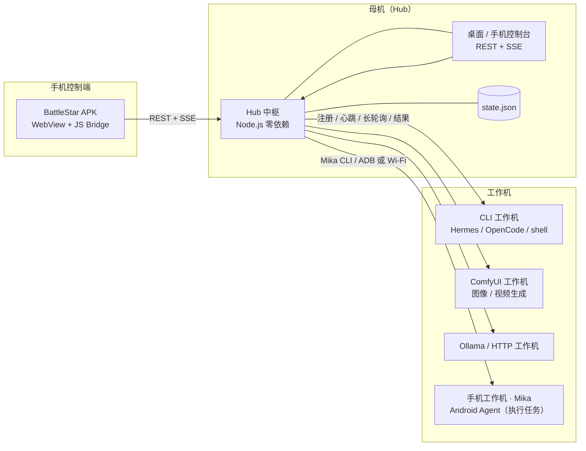

# BattleStar · 多设备 AI 管家

> 对外品牌、Hub `health.name`、Web 控制台、DSH 插件面板和 APK 显示名均为 **BattleStar**。
> 为了兼容已有设备令牌、插件安装和启动项，目录名、`@local/dsh-super-butler` 包名、`/super-butler/api/*` 路由和 `~/.super-butler` 状态目录保留旧标识符。

> 把家里多台跑着不同 AI 的设备，接进同一个「管家」：设备申报能力、管家按能力派活、手机随时看状态下指令。
> A private, multi-device AI butler for DeepSeek Harness: capability-aware routing across your own machines, phones, ComfyUI and CLI agents.

[](LICENSE)
[](package.json)
[](docs/DSH-PLUGIN.md)
[](dist/BattleStar-0.1.0.apk)

一个可私有部署的**多设备 AI 编排中枢**：

- 🧠 **能力申报**：每台设备接入时申报自己的 `models`、`profiles`、`gateways`、`skills`、资源与并发上限；
- 🟢 **在线检测**：10s 心跳 + 30s TTL，离线自动重派任务，恢复后自动上线；
- 🎯 **能力路由**：按模型 / 技能 / profile / gateway / 标签匹配，结合负载与新鲜度评分，并解释「为什么选它」；
- 📋 **任务闭环**：`queued → assigned → running → completed`，支持进度、超时、取消、重试、改派；
- 🧩 **长任务拆分**：长指令 / 长超时任务先由母机 Agnes AI 拆成可独立路由的子任务，父任务下可展开查看每个子任务；支持归档、取消归档、删除任务；
  - 默认 `instruction ≥ 800 字符` 或 `timeoutSec ≥ 900` 自动拆分；也可在 API 传 `split: true` 强制拆分；
  - 拆分需要母机进程有 `AGNES_API_KEY` / `AGNES_MODEL`（插件启动 Hub 时自动注入；独立启动 Hub 时手动设置环境变量），失败会自动回退为普通任务；
- 🧵 **任务线程**：完成/失败的任务可以「继续此任务」，新任务自动带上一步指令、输出和错误作为上下文；APK/网页/插件按线程显示每一步；Hermes CLI 任务会尽量复用同一会话（`--resume`），上下文也会随任务传给其他执行器；
- 📱 **任务列表优化**：APK/手机端任务列表内部滚动，底部导航栏固定，不再需要先滚到底才能切页；
- 🖥️ **多种工作机**：本机 CLI（Hermes / OpenCode / shell）、ComfyUI 图像生成、Ollama、HTTP 服务；
- 📱 **手机工作机**：通过 [Mika](https://github.com/wangzan101/Mika) 指挥 Android 手机执行 App/网页任务；
- 📲 **手机控制端**：Android APK（WebView + 本地配置页）加载 `/m`，看设备、发指令、看任务；它只是控制端，不执行 AI 任务；任务进度/完成/失败可在 Android 通知栏以进度条和提醒显示；
- 🧩 **DSH 插件**：在 DeepSeek Harness 侧边栏打开原生控制台，统一管理 Hub、设备与私人 API 密钥；
- 🪶 **零依赖**：Hub / 设备代理 / 前端全部零 npm 依赖，Node.js 单进程即可跑；APK 约 0.11 MB。

概念参考 [dsh-superagent-prototype](https://github.com/deepseek-ai/dsh-superagent-prototype)（目标—授权—执行—回报），
手机控制台交互参考 [dsh-Go](https://github.com/ccch1mneyyy/dsh-Go)。许可证与完整 credits 见 [CREDITS.md](CREDITS.md)。

---

## 30 秒体验

```bash
git clone https://github.com/andrewngg/dsh-superagent-battlestar.git super-butler
cd super-butler
node scripts/demo.js
```

一条命令启动 Hub + 3 台差异化模拟设备（书房工作站 / 客厅媒体中心 / 手机 Pixel），自动派发 3 条示例任务，并打印：

```
桌面控制台  http://127.0.0.1:7394/?token=demo-admin-token
手机控制台  http://<本机内网IP>:7394/m?token=demo-admin-token
加入码      demo-join-code
```

浏览器打开桌面或手机控制台即可看到设备能力、任务进度与路由解释；`Ctrl+C` 全部退出。
接真实设备见下方「安装」或 [docs/INSTALL.md](docs/INSTALL.md)。

## 架构



详细设计见 [docs/ARCHITECTURE.md](docs/ARCHITECTURE.md)，接口契约见 [docs/PROTOCOL.md](docs/PROTOCOL.md)。

### 任务怎么被派到某台设备

```
一句话指令
  → 规范化 requirements（model / skills / profile / gateway / tags / deviceId）
  → 过滤：离线、禁用、满载、缺少能力（记录 excluded 原因）
  → 评分：100 - 20×负载率 + 显式设备 15 + 能力标签 5 + 心跳新鲜度
  → 下发 run_task 命令 → 设备 ack → running → progress → result
  → 无候选时排队；设备上线或能力变化时自动重试
```

每个任务保存 `route.candidates` 与 `route.excluded`，控制台与手机端直接展示，方便排查「为什么没派给我的设备」。

## 安装：母机 + 工作机

> **角色区分（容易混淆）**
> - **手机工作机（Mika）**：属于「工作机」，负责在 Android 手机上执行 App / 网页任务，由管家下发指令。
> - **BattleStar APK / 浏览器**：属于「控制端」，只用来查看设备、发指令、看进度，本身不执行 AI 任务。
> 两者可以是同一部手机上的两个不同应用/角色。

完整的逐步说明在 **[docs/INSTALL.md](docs/INSTALL.md)**，下面是总览。

### 母机（Hub）

要求：一台常开设备（NAS / 小主机 / 旧笔记本，Windows / Linux / macOS）+ Node.js ≥ 18 + 家庭内网。

```bash
git clone https://github.com/andrewngg/dsh-superagent-battlestar.git super-butler
cd super-butler
node hub/server.js --port 7317 --host 0.0.0.0 --data-dir hub/data
```

启动日志会打印：

```
管理员令牌  adm_...
加入码      join_...
手机控制台  http://<母机IP>:7317/m?token=adm_...
本机控制台  http://127.0.0.1:7317/?token=adm_...
```

- 令牌与加入码保存在 `hub/data/state.json`（已 gitignore），请备份，不要提交；
- 验证：`curl http://<母机IP>:7317/api/health`；
- 浏览器打开控制台即可；手机浏览器可打开 `/m?token=...` 或安装 APK；
- 开机自启（Windows 任务计划 / Linux systemd）见 [docs/INSTALL.md](docs/INSTALL.md#5-开机自启可选)；
- 可选安装 DSH 插件，在 Harness 里打开控制台（见下文）。

### 工作机（Worker）

每台工作机安装 Node.js ≥ 18，复制/克隆项目，选择执行器，用母机的加入码注册：

```bash
node device-agent/agent.js \
  --hub http://<母机IP>:7317 \
  --join-code <加入码> \
  --config device-agent/configs/<你的配置>.json \
  --state-dir device-agent/.state/<设备名>
```

按能力选择配置模板：

| 工作机类型 | 执行器 | 配置模板 | 说明 |
| --- | --- | --- | --- |
| **本机 AI CLI** | `cli` | [cli-machine.example.json](device-agent/configs/cli-machine.example.json) | Hermes / OpenCode / shell；代码、调研、办公等任务 |
| **ComfyUI** | `comfyui` | [comfyui-machine.example.json](device-agent/configs/comfyui-machine.example.json) | 文生图、图生图、放大、视频；见 [SECOND-MACHINE.md](docs/SECOND-MACHINE.md) |
| **手机工作机（Mika）** | `mika` | [phone-mika.example.json](device-agent/configs/phone-mika.example.json) | 手机运行 Mika，PC 上的 `mika` CLI 作为桥；见 [MIKA-PHONE.md](docs/MIKA-PHONE.md) |
| **Ollama / HTTP** | `ollama` / `http` | [config.example.json](device-agent/config.example.json) | 本地模型或已有 Agent 服务 |
| **演示** | `simulate` | — | 无需外部服务，用于联调 |

工作机上线后，母机控制台会显示设备名、在线状态、models / profiles / gateways / skills chips 与负载。
- 工作机会自动补连：配置的 Hub IP 失效时，代理会扫描本机 IPv4 `/24` 网段的 `7317` 端口，发现 BattleStar Hub 后自动重连；跨 VLAN/不同网段请使用 DHCP 固定 IP 或主机名。
所有执行器都是可配置、可插拔的；设备主人决定允许执行什么。

### 让 AI 自动配置工作机（WORKER-SETUP）

如果工作机上有一个能执行命令的 AI Agent，把下面这段发给它，它就会读取参考文件并自动完成配置与注册：

```text
读取本仓库的 docs/WORKER-SETUP.md，把本机配置成BattleStar的「工作机」并自动注册到母机。
母机：http://<母机IP>:7317
加入码：<JOIN_CODE>
角色：cli（或 comfyui / mika / ollama / http）
设备名：<DEVICE_NAME>
可选管理员令牌（仅用于验证）：<ADMIN_TOKEN 或留空>
按文件里的步骤执行，完成后按第 7 节格式汇报。
```

参考文件：[docs/WORKER-SETUP.md](docs/WORKER-SETUP.md)

它只需要你提供：

| 信息 | 必填 | 说明 |
| --- | --- | --- |
| 母机 URL | ✅ | `http://<母机IP>:7317`，工作机必须能访问 |
| 加入码 | ✅ | 母机启动日志里的 `join_...` |
| 角色 / 执行器 | ✅ | `cli` / `comfyui` / `mika` / `ollama` / `http` |
| 管理员令牌 | 可选 | 仅用于自动验证设备是否上线、发测试任务 |
| 工作机自身 IP / 端口 | ❌ 不需要 | 工作机主动连母机，Hub 不会反向连接工作机 |

> 这不是「互相桥接」：注册、心跳、领任务都是工作机发起的出站请求（`POST /api/devices/register` → 心跳/长轮询）。
> 只有 Mika 桥需要本机连手机（ADB/Wi-Fi）、ComfyUI 需要本机连 `127.0.0.1:8188`，都与母机入站无关。

### 手机控制端（APK / 浏览器）

> 这里是**控制端**，不是工作机。手机工作机是 Mika，见上面的工作机表格与 [docs/MIKA-PHONE.md](docs/MIKA-PHONE.md)。
> APK 品牌名已改为 **BattleStar**（包名仍为 `com.superbutler.app`，可直接覆盖安装旧版）。

- 浏览器直接打开 `http://<母机IP>:7317/m?token=<管理员令牌>`，可添加到主屏幕；
- 或安装 [dist/BattleStar-0.1.0.apk](dist/BattleStar-0.1.0.apk)（Android 8+，测试签名；构建/安装见 [docs/APK.md](docs/APK.md)）。
- APK 首次打开会自动扫描同一 Wi-Fi 网段的 Hub（默认端口 7317），发现后只需填管理员令牌，不用记母机 IP；也可改端口手动扫描。
- 首次打开自动发现母机（或手动填 Hub 地址），再填管理员令牌，点「测试连接」→「进入管家」。
- 任务执行时通知栏显示**常驻进度条**，完成后推送完成/失败提醒；Android 13+ 首次启动需允许通知权限。
- APK「设置 → 手机通知（APK）」可开启**常驻通知**：有任务时显示任务进度，没有任务时显示 `X 台在线 · Y 台待命`。

### DSH 插件（可选，推荐）

`dsh-plugin/` 是一个 DeepSeek Harness bundle，安装后侧边栏出现「BattleStar」：

- 原生面板显示 **母机状态与可编辑的母机昵称**、工作机连接方式/在线状态、任务流与指令发送；
- 工作机卡片可直接重命名；母机昵称与 Hub 设置一起保存；
- 「设置」里统一保存 GitHub 账号/Token 与各模型 API Key，写入 **Harness credentials 服务**（不写项目文件、不回显）；
- 每个已配置 Token 旁有 **「测试 Token」** 按钮：GitHub 调 `/user`，DeepSeek/Agnes/豆包/OpenCode 调各自只读 `/models` 接口，返回可用/无效/无法判定与延迟；
- 插件自动检测/启动 Hub，通过 `/super-butler/api/*` 同源代理，页面不接触管理员令牌。

安装方式：

```
plugin_manager(action: "install_bundle", target: "<abs>/super-butler/dsh-plugin")
```

`projectRoot` 可在插件配置里指向项目位置，或设置 `SUPER_BUTLER_PROJECT_ROOT`；详见 [docs/DSH-PLUGIN.md](docs/DSH-PLUGIN.md)。

## 目录结构

```
super-butler/
├─ hub/                    # 母机中枢（Node 零依赖）
│  ├─ server.js            # CLI 入口，打印令牌/加入码/手机 URL
│  ├─ lib/                 # 注册表、路由、任务、HTTP、SSE、持久化、静态服务
│  ├─ web/                 # 桌面 + 手机控制台（零构建）
│  └─ test/                # 34 个 Hub 用例
├─ device-agent/           # 工作机代理
│  ├─ agent.js             # 注册/心跳/长轮询/执行/回报
│  ├─ cli-worker.js        # 本机 CLI 执行器（Hermes / OpenCode / shell）
│  ├─ lib/                 # discovery / executors / hub-client / state ...
│  ├─ configs/             # 工作机配置模板（cli / comfyui / mika / examples）
│  └─ test/                # 51 个代理用例
├─ shared/                 # manifest 规范化 / 匹配 / 评分（Hub 与代理共用）
├─ dsh-plugin/             # DSH 插件：侧边栏控制台 + 私人密钥设置
├─ android/                # APK 工程 + 手工构建流水线
├─ dist/                   # 构建产物：BattleStar-0.1.0.apk、icon-512.png
├─ scripts/                # demo.js / smoke-test.js / simulate-devices.js
├─ docs/                   # INSTALL / WORKER-SETUP / PROTOCOL / ARCHITECTURE / DEPLOY / APK / SECOND-MACHINE / MIKA-PHONE / DSH-PLUGIN
├─ CREDITS.md              # 第三方来源、许可证、商标与 AGPL 合规说明
├─ LICENSE                 # MIT
└─ package.json            # npm scripts（无依赖）
```

## API 速览

```bash
# 健康检查
curl http://<母机IP>:7317/api/health

# 设备列表（管理员令牌）
curl -H "X-Butler-Token: <adminToken>" http://<母机IP>:7317/api/devices

# 发任务：需要 Word 技能，优先级 7
curl -X POST http://<母机IP>:7317/api/tasks \
  -H "X-Butler-Token: <adminToken>" -H "Content-Type: application/json" \
  -d '{"instruction":"把本周家庭开销整理成 Word 报告","requirements":{"skills":["office-docx"]},"priority":7}'

# 实时事件（SSE）
curl -N "http://<母机IP>:7317/api/events?token=<adminToken>"
```

完整端点、数据结构、评分规则见 [docs/PROTOCOL.md](docs/PROTOCOL.md)。

## 测试与验收

```bash
# 单元测试：Hub 34 + 设备代理 51 + 共享协议 8（共 93）
node --test hub/test device-agent/test shared/test

# 受限沙箱（Node 测试运行器无法 spawn 子进程）时：
node --test --test-isolation=none hub/test device-agent/test shared/test

# 端到端冒烟：Hub + 3 台真实代理进程 + 路由 + 离线/恢复
node scripts/smoke-test.js

# 一键 demo
node scripts/demo.js
```

**实测结果**

- `hub/test` 34/34、`device-agent/test` 51/51（含 CLI worker、ComfyUI、Mika 执行器用例）、`shared/test` 8/8；
- `scripts/smoke-test.js` 全绿：注册 → 按 skills/model 路由 → 杀掉设备后 TTL 离线 → 新任务 queued 且带 `route.excluded` → 新设备上线后自动完成 → SSE 首帧 snapshot；
- `scripts/demo.js` 3 条示例任务分别路由到 3 台设备并 `completed`；
- APK 静态校验：`com.superbutler.app` / minSdk 26 / targetSdk 36 / 0.1.0，`apksigner` v1+v2+v3、`zipalign` 通过。

## 安全

- 仅建议在**家庭内网 / 私有 VPN** 使用；不要把 7317 直接暴露公网。外网访问请用 Tailscale/WireGuard 或反向代理 + HTTPS。
- 设备注册需要**加入码**；手机/控制台需要**管理员令牌**；设备令牌只能访问自己的路径。
- Hub 不执行设备上报的代码；真实执行器命令模板由设备主人配置；可先用 `simulate` 联调。
- 令牌保存于 `hub/data/state.json`（gitignore）；手机令牌存应用私有 SharedPreferences；前端用户数据按文本渲染避免 XSS。
- DSH 插件中的私人密钥存入 Harness credentials 服务（非项目文件）；不要提交 `.env`、`hub/data`、设备状态或签名密钥。
- 手机 Mika 的支付、验证码、登录与手机接管保留人工确认，远程任务不会自动批准。
- 详细边界：[docs/PROTOCOL.md](docs/PROTOCOL.md)、[docs/DEPLOY.md](docs/DEPLOY.md)。

## 已知限制

- Hub 是单点，需要一台常开设备；断网时无法下发任务。
- 当前路由是**确定性能力评分**，不是 LLM 规划器；多设备子任务 DAG 在 Roadmap。
- DSH/CLI 接口因版本而异；`dsh-cli` 与 `cli` 执行器使用可配置命令模板，需按实际环境调整。
- ComfyUI 生成的图片保存在工作机本地，暂不回传 Web 控制台（任务结果含路径）。
- APK 是 WebView 壳：自签名 HTTPS 会被拒绝（家庭内网建议 http）；无服务端推送/离线缓存/自适应图标；任务通知依赖页面保持运行，App 被系统彻底杀死后不再更新。
- 手机端 UI 截图未生成（浏览器沙箱限制）；功能已通过真实 Hub 的 DOM 级验证。

## Roadmap

1. **管家大脑**：接入 LLM planner，把一句话拆成多设备有依赖的子任务 DAG（参考 dsh-superagent 的 ticket/assignment 模型）。
2. **设备产物回传**：ComfyUI 图片/文件上传到 Hub 并在手机端预览。
3. **DSH 深度适配**：直接对接 DSH Web API / 插件协议。
4. **家庭成员与权限**：查看 / 发指令 / 管理设备分级。
5. **通知与 APK 增强**：更完善的自动发现（mDNS/跨网段）、扫码配对、离线缓存。

## 许可证与致谢

本项目以 **MIT** 发布（见 [LICENSE](LICENSE)）。

| 来源 | 许可证 | 使用方式 |
| --- | --- | --- |
| [deepseek-ai/dsh-superagent-prototype](https://github.com/deepseek-ai/dsh-superagent-prototype) | MIT | 设计概念参考（目标—授权—执行—回报、orchestrator/ticket 思路），未复制代码 |
| [ccch1mneyyy/dsh-Go](https://github.com/ccch1mneyyy/dsh-Go) | AGPL-3.0（品牌/素材另有约束） | 手机端交互灵感，未复制代码/素材/名称；本项目独立实现 |
| [deepseek-ai/deepseek-harness](https://github.com/deepseek-ai/deepseek-harness) | MIT | 运行平台与插件 API |
| [NousResearch/hermes-agent](https://github.com/NousResearch/hermes-agent) | MIT | 设备端 CLI 执行器（用户自行安装，不随仓库分发） |
| [anomalyco/opencode](https://github.com/anomalyco/opencode) | MIT | 代码任务 CLI（用户自行安装，不随仓库分发） |
| [ollama/ollama](https://github.com/ollama/ollama) | MIT | 本地模型运行时（用户自行安装） |
| [wangzan101/Mika](https://github.com/wangzan101/Mika) | Apache-2.0 | 手机端 AI Agent，通过 CLI 接入（用户自行安装，不随仓库分发） |
| [Comfy-Org/ComfyUI](https://github.com/Comfy-Org/ComfyUI) | GPL-3.0 | 图像/视频生成服务（用户自行安装，不随仓库分发） |

完整说明（构建工具、商标声明、AGPL 合规备注）见 **[CREDITS.md](CREDITS.md)**。
「DSH Superagent Battlestar / BattleStar」为本项目名称，第三方名称与素材归各自所有者；本项目与上述公司/组织无隶属关系。
