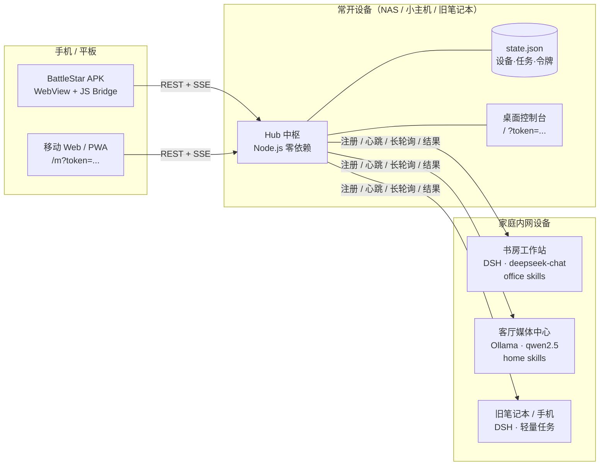
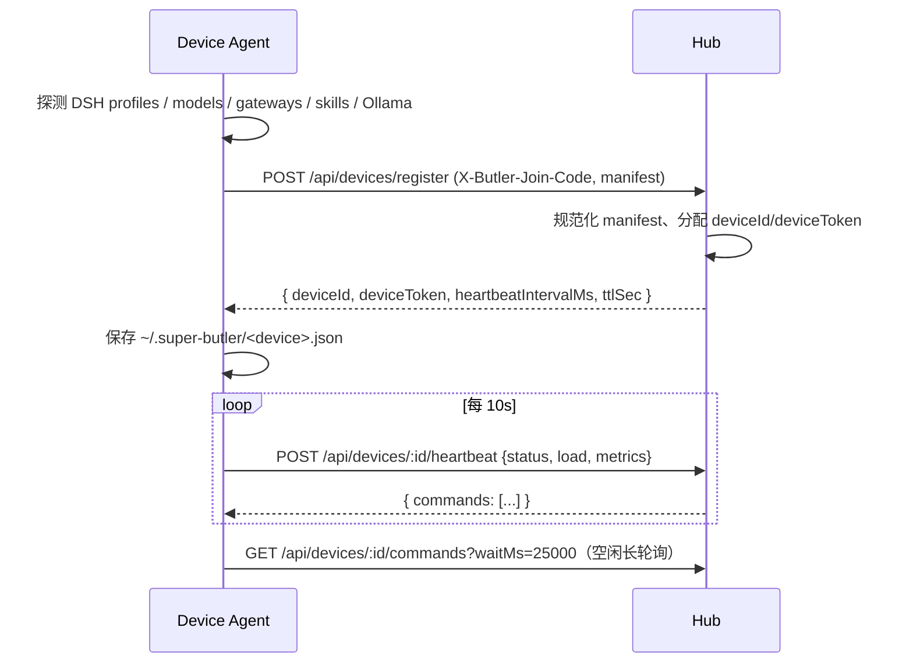
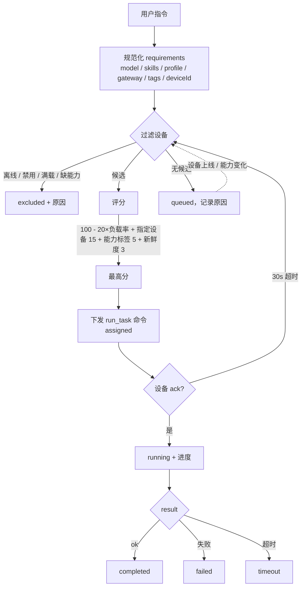
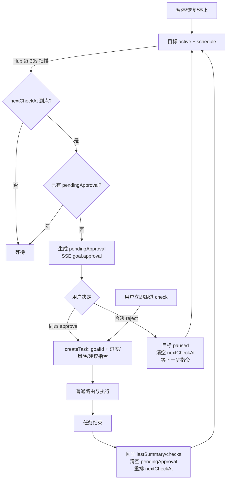

# BattleStar · 架构设计

> BattleStar 把「一个管家 + 多台家里的 AI 设备」组织成一个可观测、可指挥的私有集群。
> 设计概念参考 [dsh-superagent-prototype](https://github.com/deepseek-ai/dsh-superagent-prototype)（目标—授权—执行—回报），
> 手机端交互参考 [dsh-Go](https://github.com/ccch1mneyyy/dsh-Go)（掌上查看与控制）。

## 1. 设计目标

1. **设备即能力**：每台设备接入时申报自己有什么模型（models）、哪些 DSH profile、哪些 gateway、哪些 skills、多少并发与资源。
2. **管家即编排**：用户只写一句自然语言指令；管家根据能力、在线状态、负载与优先级选择设备，并解释“为什么选它”。
3. **状态透明**：在线/离线、空闲/忙碌、负载、心跳时间、任务队列在桌面与手机上实时可见。
4. **手机可指挥**：Android APK 通过家庭内网直连 Hub，看设备、发指令、看进度、取消/重试。
5. **零依赖、可自托管**：Hub 与设备代理都是 Node.js 单进程、零 npm 依赖；数据落本地 JSON；一条命令起 demo。

## 2. 总体架构



### 组件职责

| 组件 | 路径 | 职责 |
| --- | --- | --- |
| **Hub 中枢** | `hub/` | 设备注册表、能力清单、TTL 在线检测、任务队列与路由、SSE 事件流、Web 控制台、本地持久化 |
| **共享协议** | `shared/protocol.js` | manifest 规范化、需求匹配、评分、ID/限制常量（Hub 与设备代理共用，保证语义一致） |
| **设备代理** | `device-agent/` | 能力探测（DSH/Ollama/配置覆盖）、注册与心跳、命令领取、可插拔执行器、回报进度与结果 |
| **Web/手机控制台** | `hub/web/` | 设备状态、能力 chips、指令编排、任务时间线、SSE 实时刷新；响应式适配手机 |
| **Android APK** | `android/`、`dist/` | 原生 WebView 壳 + 首次连接配置 + JS Bridge，加载 Hub 的 `/m` |
| **演示与验收** | `scripts/` | 一键 demo（3 台模拟设备）、端到端 smoke test、截图 |

## 3. 关键流程

### 3.1 设备接入与能力申报



能力清单是**可更新的**：设备热插拔模型、重启 DSH、装上新的 skill 后，调用 `POST /api/devices/:id/manifest` 即可，Hub 会立即用新能力重试排队中的任务。

### 3.2 在线 / 离线检测

- 心跳间隔 10s，TTL 30s。
- Hub 为每个设备维护 `lastSeenAt`；超过 TTL 标记 `online:false` 并广播 `device.offline`，同时把该设备 `assigned/running` 的任务重新编排（`maxAttempts` 内）或标记失败。
- 设备重启后凭本地 `deviceId + deviceToken` 恢复注册，不重复占号；Hub 立即广播 `device.online`。
- “在线但忙碌”不会被误判离线：心跳里的 `status` 与 `load` 单独展示。

### 3.3 任务路由



评分公式（实现见 `shared/protocol.js#scoreDevice`）：

```
score = 100
      - 20 × (running / max)
      + 15  若显式指定 deviceId
      + 5   若 model.strengths 命中 requirements.hint
      + 3…1 按心跳新鲜度递减
```

每次路由都写入 `task.route = { reason, candidates[], excluded[] }`，手机和控制台会直接展示，方便排查“为什么没派给我的设备”。

#### 3.3.1 路由提示：本地文件预检（A）+ 规划器设备指派（C）

路由评分只认识 `requirements`，不认识“这条指令要改的文件在哪台机器上”。A+C 在路由之前补上这层理解，并把依据写进可审计字段 `task.routingAdvice`：

**A. 本地文件预检（确定性，默认开启）**：任务创建时若用户没有显式指定设备，Hub 扫描指令里出现的本地文件/路径（`hub/lib/preflight.js`：Windows/UNC 绝对路径、带分隔符的相对路径、扩展名白名单的裸文件名；先剔除 URL 与邮箱），在 Hub 宿主的当前工作目录、仓库根、`Downloads`、`Documents`、`Desktop`、用户 home 下查找（默认深度 3、索引预算 150ms、总预算 250ms）。
命中即把 `requirements.deviceId` 固定到「本机」设备（优先 `BUTLER_LOCAL_DEVICE_ID`，否则 tags 含「本机」的设备，否则名称含主机名者），并把依据写入 `task.routingAdvice.preflight`、`task.route.reason` 前缀（「本地文件预检：…」）、任务事件与任务记录的「## 路由提示」章节。显式 `deviceId` 优先，不被覆盖；`createTask`/`createPlanTask` 的自动重试与 follow-up 同样继承/重算该提示。关闭方式：Hub 选项 `preflight:false` 或环境变量 `BUTLER_PREFLIGHT=0`。

**C. 设备感知的 Agnes 规划器指派**：长任务拆分时，Hub 把未禁用设备清单（id/名称/平台/tags/是否本机/skills/models，`deviceInventory()`）传给 planner；子任务可额外返回可选 `deviceId`、`tags`。Hub 负责校验：`deviceId` 必须存在于注册设备且未禁用，`tags` 必须至少存在于一台设备，非法值丢弃并回退自动路由。优先级为：用户显式 `deviceId` > 子任务指令自身命中的本地文件预检 > 规划器指派 > 父任务预检 pin > 自动路由；规划器指派还必须满足用户的其他要求（model/skills/tags），不满足则忽略。规划器指派写入子任务 `routingAdvice.planner` 与 `route.reason` 前缀（「Agnes 指派：…」）。

**审计与持久化**：`task.routingAdvice = { preflight?, planner? }` 会随任务一起写入 `state.json` 并在重启后恢复，同时展示在任务记录中，因此“为什么派到这台机器”在控制台、手机和 Markdown 记录里都可追溯。

**并发**：母机 `first-machine` 的 `limits.maxConcurrentTasks` 现为 4；超出容量的任务保持 `queued`，槽位释放后由 Hub 自动重派，拆分出的子任务不会因为一台机器满载就失败。

### 3.4 命令与执行

- Hub 不执行任何用户代码；它只把 `run_task` 命令交给设备代理。
- 设备代理收到命令后先 `ack`（assigned→running），再交给执行器，定期 `progress`（执行期间额外发 `keepalive` 续期超时窗口），最终 `result`。
- 执行器可插拔：`simulate`（演示）、`cli`（本机 Hermes / OpenCode / shell）、`dsh-cli`（命令模板调用 DSH）、`shell`、`http`（设备本地服务）、`ollama`。
- 本机 CLI 的实时步骤：`cli` 执行器默认用 `hermes chat -q "<指令>" --format stream-json` 执行，逐行解析 `tool_use` / `tool_result` 事件，把「正在执行：工具」「子任务：…」「执行步骤：…」写入临时进度文件；设备代理每 500ms 轮询并转成 `progress` 上报（不占用子进程管道，Windows 沙箱安全）。任务卡片显示最新步骤，详情抽屉的事件时间线保留历史步骤；旧版 Hermes 不支持 `stream-json` 时自动回退 `-z` 一次性调用，只有粗粒度进度。
- 设备端限制并发（`limits.maxConcurrentTasks`）；Hub 的单任务超时按“最后一次设备活动”计时（keepalive 续期），设备失联/卡死才超时，实际时长由执行器 `timeoutMs` 约束；超时后设备主动回报失败，Hub 可按需重试或改派。
- 自动重试：运行超时在 `maxAttempts` 内由 Hub 自动重新排队（先下发 `cancel_task`），不需要人工点「重试」。
- 系统自重启：`POST /api/system/restart`（或控制台「设置 → 系统维护 → 重启整套系统」）先给在线设备下发 `restart_agent`，各代理拉起新进程后优雅退出，随后 Hub 自身 re-exec；自重启恢复时运行中的任务自动重新排队，不占用重试次数。
- 任务执行记录（backtrace）：Hub 每次任务变更都会落一份 Markdown 到 `BUTLER_RECORD_DIR`（默认 `<仓库>/task-records/`，gitignored），含指令/输出/事件时间线（带事件间隔）/耗时分解/路由/相关日志，并维护 `index.md` 总索引；关闭/自重启前强制落盘，也可用 `scripts/export-task-records.js` 离线补导。
- 控制台：顶栏「执行记录」抽屉通过 `GET /api/records` / `/api/records/:id` 浏览 Markdown（搜索、状态筛选、复制、下载、父子任务互跳）；设置页「系统默认语言」写入 `hub/data/settings.json`（默认 zh-CN，可切 en），前端 `assets/i18n.js` 负责界面本地化（任务数据保持原文）。

### 3.5 手机端

- APK 启动：首次进入配置页（Hub 地址 + 管理员令牌）→ 保存到 SharedPreferences → WebView 加载 `<hub>/m?token=...`。
- 之后每次启动自动直连；加载失败显示本地错误页，可重试或改配置。
- 页面通过 SSE 接收增量事件，断线自动重连；无法建立 SSE 时降级为 5 秒轮询快照。
- 手机与 Hub 必须处于同一内网（或通过 WireGuard/Tailscale 等组网）；不建议把 7317 端口直接暴露公网。

### 3.6 长期目标（Goals）



- 目标执行前必须获得用户同意：调度器到点只生成 `pendingApproval` 提案（管理员通过 `GET /api/approvals` 或控制台看到），批准后才创建跟进任务；否决则目标转入 `paused`，不再排期，等用户恢复或下一步指令。`POST /api/goals/:id/check` 是用户主动发起，视为已同意。
- 目标不是新任务类型：每次跟进就是一条普通任务，通过 `task.goalId` 关联，复用路由/并发/重试/记录全套机制；优先级手动 7、定时 4。
- 调度由 Hub 内置定时器完成（`BUTLER_GOAL_TICK_MS`，默认 30000ms），无需外部 cron；Hub 停机期间错过的检查不补跑，恢复后按计划排下一次。
- 同一个目标同时只允许一条跟进任务（`runningTaskId` 防重），已有待确认提案时亦不重复生成，避免目标检查自我叠加。
- 目标持久化在 `state.json` 的 `goals` 字段；任务结束回调 `_goalTaskFinished` 写入 `checks`（最多 20 条）与 `lastSummary`，并通过 SSE `goal.updated` 实时推给控制台。
- 每晚总结（Nightly Review）：Hub 每天本地时间 `nightlyReviewTime`（默认 22:00，可用构造参数、`BUTLER_NIGHTLY_REVIEW_TIME` 或 `BUTLER_NIGHTLY_REVIEW=0` 控制）创建一条普通任务，汇总所有目标、最近 24 小时任务与子任务进度，输出 Markdown：目标进度 / 任务复盘 / 明天工作方向 / 需要确认事项 / 目标下一步细节；状态与全文保存在 `state.json` 的 `nightlyReview` 字段，控制台通过 `nightly.review.updated` 实时展示，也可用 `POST /api/nightly-review/run` 手动强制生成。

### 3.7 提醒（Reminders）

- 提醒是「到点通知」的纯数据：`{title, note, dueAt, repeat, notifyStyle, enabled}` 保存在 `state.json` 的 `reminders` 字段；Hub 负责 CRUD、排序与 SSE 广播，**不做轮询、不发通知**。
- 通知只在 Android APK：
  - 页面加载/增删改/启停后，Web 控制台通过 JS Bridge `ButlerBridge.syncReminders(json)` 把提醒列表交给原生 `ReminderScheduler`；
  - `ReminderScheduler` 用 `AlarmManager` 排程（Android 12+ 有 `SCHEDULE_EXACT_ALARM` 时 `setExactAndAllowWhileIdle`，否则回退 `setAndAllowWhileIdle`）；到点 `ReminderReceiver` 按每条提醒的 `notifyStyle` 选择通知渠道：`gentle` → `butler_reminders`（普通系统提示音），`alarm` → `butler_reminders_alarm`（`AudioAttributes.USAGE_ALARM` 闹钟音 + 长震动 + `CATEGORY_ALARM`）；通知 id 从 7500 起，避开任务通知 7300/常驻通知 7400；
  - Receiver 本地推进重复提醒（daily +1d / weekly +7d，none 置为停用），然后 `POST /api/reminders/:id/fire` 回写 Hub；失败静默，等下次快照/页面同步校正；
  - App 被系统杀死或重启不影响已排闹钟；`BOOT_COMPLETED` / `MY_PACKAGE_REPLACED` 后 `BootReceiver` 从 SharedPreferences 缓存重排；
  - 前台服务每 5s 轮询 `/api/snapshot` 时也会同步 `reminders`，作为后台兜底。
- 浏览器只管理、不弹通知；控制台提醒页展示提示条说明这一点。多台手机各自排程，回写以 Hub 为准（同一提醒会在多台手机上同时响）。

## 4. 数据模型

### 4.1 设备（Device）

```jsonc
{
  "id": "dev_ab12cd34",
  "name": "书房工作站",
  "nickname": "主力开发机（写代码）",
  "platform": "windows",
  "kind": "dsh",
  "online": true,
  "status": "idle",
  "lastSeenAt": "2026-11-05T08:00:10.000Z",
  "load": { "running": 0, "max": 2 },
  "capabilities": {
    "models": [{ "id": "deepseek-chat", "provider": "deepseek", "strengths": ["code"], "available": true }],
    "profiles": [{ "id": "desktop", "name": "DSH Desktop", "plugins": [] }],
    "gateways": [{ "id": "openai-gateway", "kind": "openai-compatible", "baseUrl": "..." }],
    "skills": [{ "id": "office-docx", "name": "Word 文档" }],
    "resources": { "cpuCores": 16, "memoryGB": 32, "gpu": "RTX 4070" },
    "limits": { "maxConcurrentTasks": 2 }
  }
}
```

`name` 是设备自报的机器名（每次 manifest 上报都会刷新）；`nickname` 是用户在 Hub 侧设置的用途昵称（≤40 字，存在 `state.json`，`PATCH /api/devices/:id { nickname }` 设置，空串清除）。展示时优先 `nickname`，回退 `name`；任务派发的 `assignedDeviceName` 也按这个顺序取。

### 4.2 任务（Task）

状态机：`queued → assigned → running → completed | failed | timeout`，任意可 `cancelled`，失败可 `retry` 重新入队。
任务保存完整事件时间线与路由解释；`output` 支持文本、Markdown、artifacts（文件/链接）。
`route` 记录 `reason/candidates/excluded`；`routingAdvice` 记录路由提示的来源（`preflight` 本地文件预检、`planner` Agnes 规划指派），随任务持久化并写入任务记录。

### 4.3 长期目标（Goal）

状态机：`active ⇄ paused`，可 `stopped`（用户停止，终态）或 `completed`（目标达成，终态）；`stopped/completed` 不再自动排期。
字段：`id/title/nickname/description/status/schedule/nextCheckAt/lastCheckAt/lastCheckStatus/lastSummary/runningTaskId/taskIds[]/checks[]/pendingApproval`（`nickname` 是用户给目标起的称呼，≤40 字、可选，控制台卡片/提醒/跟进指令/每日总结优先用它，留空回退 `title`；最近 20 次跟进记录，含时间/任务/状态/摘要/错误；`pendingApproval={id,at,reason,instruction,source}` 表示到点后等待用户同意的跟进提案，持久化并在重启后恢复）。
`schedule` 为 `{type:'daily',time:'HH:mm'}`（本地时区，默认 09:00）或 `{type:'interval',minutes}`（5 分钟–7 天）。
`state.json` 顶层 `nightlyReview` 保存每晚总结：`{date,taskId,status,startedAt,finishedAt,summary,error}`。

### 4.4 提醒（Reminder）

```jsonc
{
  "id": "rem_a1b2c3",
  "title": "吃药",
  "note": "饭后",
  "dueAt": 1794186000000,       // epoch 毫秒
  "repeat": "daily",            // none | daily | weekly
  "notifyStyle": "gentle",      // gentle（普通通知，默认） | alarm（闹钟式，APK 原生渠道）
  "enabled": true,
  "createdAt": "...", "updatedAt": "...",
  "lastFiredAt": null, "fireCount": 0
}
```

`dueAt` 用数字毫秒（不用 ISO 字符串），便于 APK 直接排 `AlarmManager`；`lastFiredAt` 由 APK 的 `fire` 回写，`fireCount` 累计触发次数。`repeat=none` 触发后 `enabled=false`；`daily/weekly` 触发后由 Hub 推进 `dueAt` 到下一次。`notifyStyle` 决定 APK 到点时的通知方式（`gentle` 普通通知 / `alarm` 闹钟式），Hub 不强校验设备端行为，控制台浏览器不弹通知。

### 4.5 事件（Event）

设备与任务的变更都产生事件，经 SSE 推送给所有控制台；Hub 本身保留最近事件用于快照与排查。

## 5. 安全模型

| 风险 | 缓解 |
| --- | --- |
| 内网被蹭 | 设备注册需要加入码；手机需要管理员令牌 |
| 设备越权 | 设备令牌只能访问自己的路径；管理员令牌才能读全量、发任务 |
| 令牌泄露 | 令牌只存本地 state.json（文件权限由系统保证）；手机存应用私有 SharedPreferences；支持重新生成 |
| 任务注入 / 越权执行 | Hub 不执行代码；设备执行器可配置白名单/模拟模式；`dsh-cli`/`shell` 模板由设备主自己配置 |
| 公网暴露 | 默认仅家庭内网；文档建议反代 + TLS + 强令牌，或用 Tailscale/WireGuard |
| XSS | 前端所有用户数据用 `textContent` 渲染，不使用 `innerHTML` 拼接 |

## 6. 非目标与已知限制

- Hub 是**单点**：常开设备（NAS/小主机）上跑；断网时任务无法下发。
- 设备端执行器是“薄适配层”：DSH 的命令行/接口因版本而异，默认提供可配置命令模板与模拟器，生产环境需要按实际 DSH 版本调模板。
- 路由评分本身是确定性规则；长任务拆分与子任务设备指派由 Agnes 规划器（LLM）提供建议，Hub 校验后执行（见 3.3.1）。未显式指定设备、预检未命中的任务仍按评分 + 心跳新鲜度选择，可能落到非预期的机器上——需要确定性时请显式指定设备，或让指令直接提到本机文件。
- 本地文件预检只做**存在性**判断，不会把文件同步到别的机器；命中后任务会固定到 Hub 宿主执行，跨机执行需要共享盘或自行同步。
- APK 是 WebView 壳（内网直连），不是完整原生客户端；离线缓存与推送通知不在 v1 范围。提醒通知是例外：由原生 `AlarmManager` 排程，App 被杀死/手机重启后仍可触发；但精确闹钟权限被撤销时会退化为非精确（Doze 下可能延迟数分钟），通知权限被拒时只回写不弹窗。「闹钟」方式只是高优先级通知 + 闹钟音/震动（非系统级闹钟，不会全屏），受勿扰模式、音量与渠道设置影响；通知渠道属性创建后不可变。

## 7. Roadmap

1. **管家大脑**：Hub 增加 LLM planner，把一句话拆成有依赖关系的多设备任务 DAG（参考 dsh-superagent 的 ticket/assignment 模型）。
2. **设备端 DSH 深度适配**：直接对接 DSH 的 Web API / 插件协议，而不是命令模板。
3. **多用户与权限**：家庭成员角色（查看/发指令/管理设备）。
4. **通知**：任务完成/失败推送到手机（APK 前台服务或 ntfy/Telegram 网关）。
5. **APK 原生增强**：扫码配对、局域网自动发现（mDNS）、离线任务列表、生物识别解锁。
