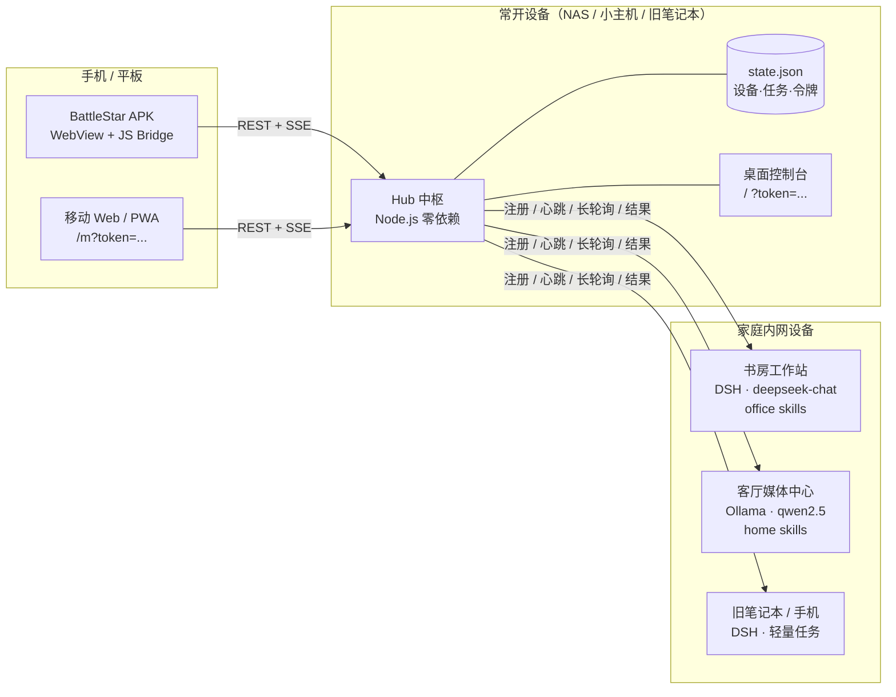
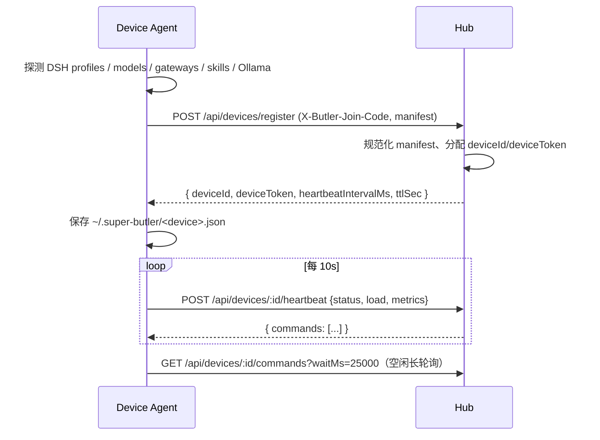
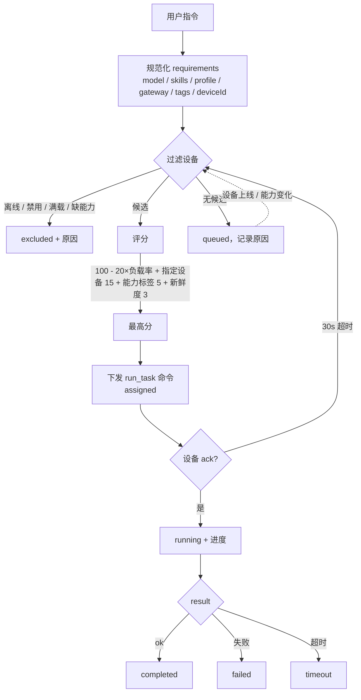

# BattleStar · 架构设计

> BattleStar 把「一个管家 + 多台家里的 AI 设备」组织成一个可观测、可指挥的私有集群。
> 设计概念参考 [dsh-superagent-prototype](https://github.com/deepseek-ai/dsh-superagent-prototype)（目标—授权—执行—回报），
> 手机端交互参考 [dsh-Go](https://github.com/ccch1mneyyy/dsh-Go)（掌上查看与控制）。

## 1. 设计目标

1. **设备即能力**：每台设备接入时申报自己有什么模型（models）、哪些 DSH profile、哪些 gateway、哪些 skills、多少并发与资源。
2. **管家即编排**：用户只写一句自然语言指令；管家根据能力、在线状态、负载与优先级选择设备，并解释“为什么选它”。
3. **状态透明**：在线/离线、空闲/忙碌、负载、心跳时间、任务队列在桌面与手机上实时可见。
4. **手机可指挥**：Android APK 通过家庭内网直连 Hub，看设备、发指令、看进度、取消/重试。
5. **零依赖、可自托管**：Hub 与设备代理都是 Node.js 单进程、零 npm 依赖；数据落本地 JSON；一条命令起 demo。

## 2. 总体架构



### 组件职责

| 组件 | 路径 | 职责 |
| --- | --- | --- |
| **Hub 中枢** | `hub/` | 设备注册表、能力清单、TTL 在线检测、任务队列与路由、SSE 事件流、Web 控制台、本地持久化 |
| **共享协议** | `shared/protocol.js` | manifest 规范化、需求匹配、评分、ID/限制常量（Hub 与设备代理共用，保证语义一致） |
| **设备代理** | `device-agent/` | 能力探测（DSH/Ollama/配置覆盖）、注册与心跳、命令领取、可插拔执行器、回报进度与结果 |
| **Web/手机控制台** | `hub/web/` | 设备状态、能力 chips、指令编排、任务时间线、SSE 实时刷新；响应式适配手机 |
| **Android APK** | `android/`、`dist/` | 原生 WebView 壳 + 首次连接配置 + JS Bridge，加载 Hub 的 `/m` |
| **演示与验收** | `scripts/` | 一键 demo（3 台模拟设备）、端到端 smoke test、截图 |

## 3. 关键流程

### 3.1 设备接入与能力申报



能力清单是**可更新的**：设备热插拔模型、重启 DSH、装上新的 skill 后，调用 `POST /api/devices/:id/manifest` 即可，Hub 会立即用新能力重试排队中的任务。

### 3.2 在线 / 离线检测

- 心跳间隔 10s，TTL 30s。
- Hub 为每个设备维护 `lastSeenAt`；超过 TTL 标记 `online:false` 并广播 `device.offline`，同时把该设备 `assigned/running` 的任务重新编排（`maxAttempts` 内）或标记失败。
- 设备重启后凭本地 `deviceId + deviceToken` 恢复注册，不重复占号；Hub 立即广播 `device.online`。
- “在线但忙碌”不会被误判离线：心跳里的 `status` 与 `load` 单独展示。

### 3.3 任务路由



评分公式（实现见 `shared/protocol.js#scoreDevice`）：

```
score = 100
      - 20 × (running / max)
      + 15  若显式指定 deviceId
      + 5   若 model.strengths 命中 requirements.hint
      + 3…1 按心跳新鲜度递减
```

每次路由都写入 `task.route = { reason, candidates[], excluded[] }`，手机和控制台会直接展示，方便排查“为什么没派给我的设备”。

### 3.4 命令与执行

- Hub 不执行任何用户代码；它只把 `run_task` 命令交给设备代理。
- 设备代理收到命令后先 `ack`（assigned→running），再交给执行器，定期 `progress`，最终 `result`。
- 执行器可插拔：`simulate`（演示）、`dsh-cli`（命令模板调用 DSH）、`shell`、`http`（设备本地服务）、`ollama`。
- 设备端限制并发（`limits.maxConcurrentTasks`）与超时；超时会主动回报失败，Hub 之后可按需重试或改派。

### 3.5 手机端

- APK 启动：首次进入配置页（Hub 地址 + 管理员令牌）→ 保存到 SharedPreferences → WebView 加载 `<hub>/m?token=...`。
- 之后每次启动自动直连；加载失败显示本地错误页，可重试或改配置。
- 页面通过 SSE 接收增量事件，断线自动重连；无法建立 SSE 时降级为 5 秒轮询快照。
- 手机与 Hub 必须处于同一内网（或通过 WireGuard/Tailscale 等组网）；不建议把 7317 端口直接暴露公网。

## 4. 数据模型

### 4.1 设备（Device）

```jsonc
{
  "id": "dev_ab12cd34",
  "name": "书房工作站",
  "platform": "windows",
  "kind": "dsh",
  "online": true,
  "status": "idle",
  "lastSeenAt": "2026-11-05T08:00:10.000Z",
  "load": { "running": 0, "max": 2 },
  "capabilities": {
    "models": [{ "id": "deepseek-chat", "provider": "deepseek", "strengths": ["code"], "available": true }],
    "profiles": [{ "id": "desktop", "name": "DSH Desktop", "plugins": [] }],
    "gateways": [{ "id": "openai-gateway", "kind": "openai-compatible", "baseUrl": "..." }],
    "skills": [{ "id": "office-docx", "name": "Word 文档" }],
    "resources": { "cpuCores": 16, "memoryGB": 32, "gpu": "RTX 4070" },
    "limits": { "maxConcurrentTasks": 2 }
  }
}
```

### 4.2 任务（Task）

状态机：`queued → assigned → running → completed | failed | timeout`，任意可 `cancelled`，失败可 `retry` 重新入队。
任务保存完整事件时间线与路由解释；`output` 支持文本、Markdown、artifacts（文件/链接）。

### 4.3 事件（Event）

设备与任务的变更都产生事件，经 SSE 推送给所有控制台；Hub 本身保留最近事件用于快照与排查。

## 5. 安全模型

| 风险 | 缓解 |
| --- | --- |
| 内网被蹭 | 设备注册需要加入码；手机需要管理员令牌 |
| 设备越权 | 设备令牌只能访问自己的路径；管理员令牌才能读全量、发任务 |
| 令牌泄露 | 令牌只存本地 state.json（文件权限由系统保证）；手机存应用私有 SharedPreferences；支持重新生成 |
| 任务注入 / 越权执行 | Hub 不执行代码；设备执行器可配置白名单/模拟模式；`dsh-cli`/`shell` 模板由设备主自己配置 |
| 公网暴露 | 默认仅家庭内网；文档建议反代 + TLS + 强令牌，或用 Tailscale/WireGuard |
| XSS | 前端所有用户数据用 `textContent` 渲染，不使用 `innerHTML` 拼接 |

## 6. 非目标与已知限制

- Hub 是**单点**：常开设备（NAS/小主机）上跑；断网时任务无法下发。
- 设备端执行器是“薄适配层”：DSH 的命令行/接口因版本而异，默认提供可配置命令模板与模拟器，生产环境需要按实际 DSH 版本调模板。
- 当前任务路由是确定性规则评分，不是 LLM 规划器；后续可接入一个“管家 LLM”把自然语言拆成多设备子任务（见 Roadmap）。
- APK 是 WebView 壳（内网直连），不是完整原生客户端；离线缓存与推送通知不在 v1 范围。

## 7. Roadmap

1. **管家大脑**：Hub 增加 LLM planner，把一句话拆成有依赖关系的多设备任务 DAG（参考 dsh-superagent 的 ticket/assignment 模型）。
2. **设备端 DSH 深度适配**：直接对接 DSH 的 Web API / 插件协议，而不是命令模板。
3. **多用户与权限**：家庭成员角色（查看/发指令/管理设备）。
4. **通知**：任务完成/失败推送到手机（APK 前台服务或 ntfy/Telegram 网关）。
5. **APK 原生增强**：扫码配对、局域网自动发现（mDNS）、离线任务列表、生物识别解锁。
