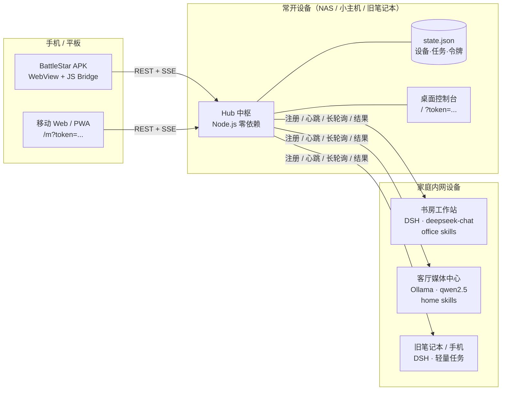
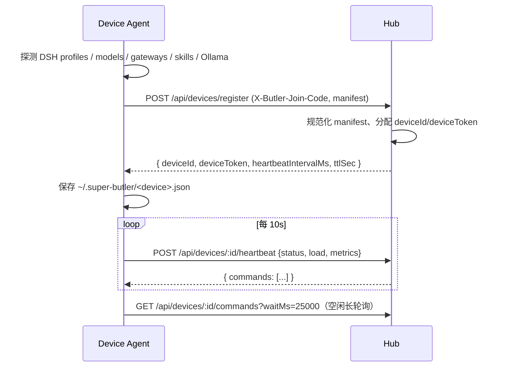
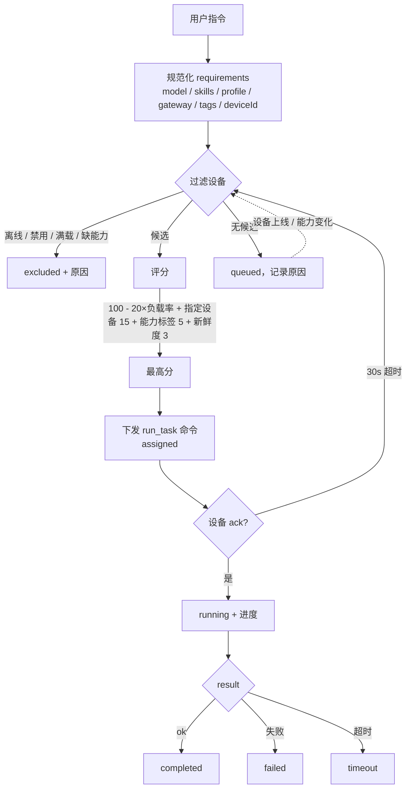
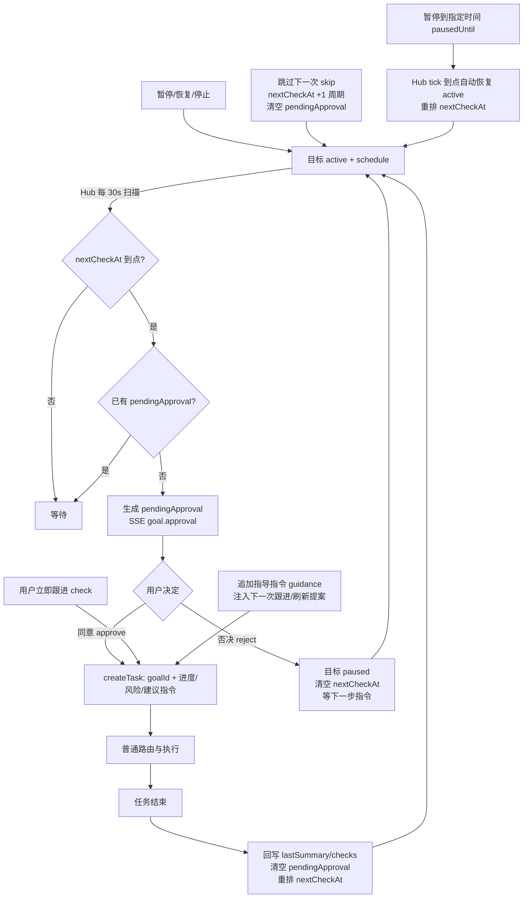

# BattleStar · 架构设计

> BattleStar 把「一个管家 + 多台家里的 AI 设备」组织成一个可观测、可指挥的私有集群。
> 设计概念参考 [dsh-superagent-prototype](https://github.com/deepseek-ai/dsh-superagent-prototype)（目标—授权—执行—回报），
> 手机端交互参考 [dsh-Go](https://github.com/ccch1mneyyy/dsh-Go)（掌上查看与控制）。

## 1. 设计目标

1. **设备即能力**：每台设备接入时申报自己有什么模型（models）、哪些 DSH profile、哪些 gateway、哪些 skills、多少并发与资源。
2. **管家即编排**：用户只写一句自然语言指令；管家根据能力、在线状态、负载与优先级选择设备，并解释“为什么选它”。
3. **状态透明**：在线/离线、空闲/忙碌、负载、心跳时间、任务队列在桌面与手机上实时可见。
4. **手机可指挥**：Android APK 通过家庭内网直连 Hub，看设备、发指令、看进度、取消/重试。
5. **零依赖、可自托管**：Hub 与设备代理都是 Node.js 单进程、零 npm 依赖；数据落本地 JSON；一条命令起 demo。

## 2. 总体架构



### 组件职责

| 组件 | 路径 | 职责 |
| --- | --- | --- |
| **Hub 中枢** | `hub/` | 设备注册表、能力清单、TTL 在线检测、任务队列与路由、SSE 事件流、Web 控制台、本地持久化 |
| **共享协议** | `shared/protocol.js` | manifest 规范化、需求匹配、评分、ID/限制常量（Hub 与设备代理共用，保证语义一致） |
| **设备代理** | `device-agent/` | 能力探测（DSH/Ollama/配置覆盖）、注册与心跳、命令领取、可插拔执行器、回报进度与结果 |
| **Web/手机控制台** | `hub/web/` | 设备状态、能力 chips、指令编排、任务时间线、SSE 实时刷新；响应式适配手机 |
| **Android APK** | `android/`、`dist/` | 原生 WebView 壳 + 首次连接配置 + JS Bridge，加载 Hub 的 `/m` |
| **演示与验收** | `scripts/` | 一键 demo（3 台模拟设备）、端到端 smoke test、截图 |

## 3. 关键流程

### 3.1 设备接入与能力申报



能力清单是**可更新的**：设备热插拔模型、重启 DSH、装上新的 skill 后，调用 `POST /api/devices/:id/manifest` 即可，Hub 会立即用新能力重试排队中的任务。

### 3.2 在线 / 离线检测

- 心跳间隔 10s，TTL 30s。
- Hub 为每个设备维护 `lastSeenAt`；超过 TTL 标记 `online:false` 并广播 `device.offline`，同时把该设备 `assigned/running` 的任务重新编排（`maxAttempts` 内）或标记失败。
- 设备重启后凭本地 `deviceId + deviceToken` 恢复注册，不重复占号；Hub 立即广播 `device.online`。
- “在线但忙碌”不会被误判离线：心跳里的 `status` 与 `load` 单独展示。

### 3.3 任务路由



评分公式（实现见 `shared/protocol.js#scoreDevice`）：

```
score = 100
      - 20 × (running / max)
      + 15  若显式指定 deviceId
      + 5   若 model.strengths 命中 requirements.hint
      + 3…1 按心跳新鲜度递减
```

每次路由都写入 `task.route = { reason, candidates[], excluded[] }`，手机和控制台会直接展示，方便排查“为什么没派给我的设备”。

#### 3.3.1 路由提示：本地文件预检（A）+ 规划器设备指派（C）

路由评分只认识 `requirements`，不认识“这条指令要改的文件在哪台机器上”。A+C 在路由之前补上这层理解，并把依据写进可审计字段 `task.routingAdvice`：

**A. 本地文件预检（确定性，默认开启）**：任务创建时若用户没有显式指定设备，Hub 扫描指令里出现的本地文件/路径（`hub/lib/preflight.js`：Windows/UNC 绝对路径、带分隔符的相对路径、扩展名白名单的裸文件名；先剔除 URL 与邮箱），在 Hub 宿主的当前工作目录、仓库根、`Downloads`、`Documents`、`Desktop`、用户 home 下查找（默认深度 3、索引预算 150ms、总预算 250ms）。
命中即把 `requirements.deviceId` 固定到「本机」设备（优先 `BUTLER_LOCAL_DEVICE_ID`，否则 tags 含「本机」的设备，否则名称含主机名者），并把依据写入 `task.routingAdvice.preflight`、`task.route.reason` 前缀（「本地文件预检：…」）、任务事件与任务记录的「## 路由提示」章节。显式 `deviceId` 优先，不被覆盖；`createTask`/`createPlanTask` 的自动重试与 follow-up 同样继承/重算该提示。关闭方式：Hub 选项 `preflight:false` 或环境变量 `BUTLER_PREFLIGHT=0`。

**C. 设备感知的 Agnes 规划器指派**：长任务拆分时，Hub 把未禁用设备清单（id/名称/平台/tags/是否本机/skills/models，`deviceInventory()`）传给 planner；子任务可额外返回可选 `deviceId`、`tags`。Hub 负责校验：`deviceId` 必须存在于注册设备且未禁用，`tags` 必须至少存在于一台设备，非法值丢弃并回退自动路由。优先级为：用户显式 `deviceId` > 子任务指令自身命中的本地文件预检 > 规划器指派 > 父任务预检 pin > 自动路由；规划器指派还必须满足用户的其他要求（model/skills/tags），不满足则忽略。规划器指派写入子任务 `routingAdvice.planner` 与 `route.reason` 前缀（「Agnes 指派：…」）。

**审计与持久化**：`task.routingAdvice = { preflight?, planner? }` 会随任务一起写入 `state.json` 并在重启后恢复，同时展示在任务记录中，因此“为什么派到这台机器”在控制台、手机和 Markdown 记录里都可追溯。

**D. 执行计划（并行组 / 依赖 / 卡点）**：规划器在拆分时还要判断“哪些子任务能同时做、哪些必须按顺序、卡住了怎么办”，并把结论放进 `execution = { strategy: "parallel" | "sequential" | "mixed", groups: [{ name, mode, subtaskIndexes }], blockerPolicy: "stop-and-ask" | "continue" }`；每个子任务可带 `dependsOn`（只允许指向更早的序号，Hub 校验并去环）与 `parallelGroup`。Hub 把它落到父任务的 `plan`（strategy/blockerPolicy/groups）和子任务的 `planStep / planGroup / planDependsOn / planDependsOnTaskIds`，并在路由前加一道依赖闸门（`_planDependencyGate`）：

- 依赖还没完成：子任务保持 `queued`，`route.reason` 显示「等待前置子任务：第 N 步…」，不会提前占用设备。
- 前序子任务失败/超时/取消：依赖它的子任务显示「卡点：…等待确认（重试该子任务或取消本计划）」，父任务 `progress.blocked = true` 并追加 `blocked` 事件，控制台/手机显示「卡点」标记。
- 默认 `blockerPolicy = "stop-and-ask"`：卡住后不自动跳过，等用户决定；用户重试失败子任务、或回答等待中的问题后，`_updateParentTask → _advancePlan` 会自动放行后续依赖子任务。
- 取消某个子任务会级联取消依赖它的后续排队子任务，避免悬空依赖。

**排队与 Mika 单并发**：设备名额按“真实占用”计算（`assigned` / `running` / `waiting`，含已下发但尚未 ack 的任务），不是只看 `load.running`，避免单并发设备（如 Mika 手机 `limits.maxConcurrentTasks = 1`）在 ack 前被并行塞入多个任务。超出容量的任务保持 `queued`，每次任务结束、失败子任务重试、依赖满足都会触发 `_advancePlan` + `retryQueuedTasks` 重新派发。规划器 prompt 会收到每台设备的并发上限，并明确建议：需要 Mika 手机的子任务超过 2 个时用 `dependsOn` 串行排队。

**并发**：母机 `first-machine` 的 `limits.maxConcurrentTasks` 现为 4；超出容量的任务保持 `queued`，槽位释放后由 Hub 自动重派，拆分出的子任务不会因为一台机器满载就失败。

#### 3.3.2 派发亲和：母机 / 项目 / 线程（`routing-affinity`）

路由评分只比较“当前谁更空/更新鲜”，不理解“这台机器有没有这个项目的上下文”。派发亲和在评分之前加一层软锁定，目标是把同一件事留在知道上下文的机器上：

- **优先级**：显式 `requirements.deviceId`（硬锁，只在指定设备评分）> `task.affinity.deviceId`（任务首次派发或重试沿用）> 同 `(threadId||id)` 线程上次执行的主机 > `requirements.project` 的项目亲和（成功完成后 `projectAffinity.set(project, deviceId)`，随 `state.routing.projectAffinity` 持久化，上限 200 条）> 母机（`settings.mainDeviceId`，为空时 `_localDevice()`：`BUTLER_LOCAL_DEVICE_ID` > tags 含「本机」> 名称含主机名）> 常规评分。
- **等待而不换机**：首选设备离线、或真实占用（assigned/running/waiting）达到 `limits.maxConcurrentTasks` 时，任务保持 `queued` 并写 `route.reason = "…亲和等待：<原因>"`，只在 reason 变化时广播/落盘；设备上线、槽位释放（`retryQueuedTasks`）后自动派回。设备不存在/禁用/缺能力才回退普通评分，并在 `route.reason` 注明「回退普通路由」。
- **计划子任务特例**：`parentTaskId` 非空的子任务若因线程亲和指向的设备离线/并发满，直接回退自动路由（并行子任务不能被单并发设备卡住）；显式 deviceId 与任务原主机不受影响。
- **失败语义**：`_finishTask(completed)` 记录项目亲和；任务内容层失败保留 `task.affinity`，手动重试回到原主机；`_dispatchFailure`（ack 超时/设备掉线，任务未真正执行）清空 `task.affinity` 并按 `_avoidDeviceIds` 重派，避免把“机器没跑起来”误判成“项目上下文不匹配”。
- **自动标签**：设备 manifest 的 `tags` 之外，Hub 按「该设备成功执行过哪些项目」推导 `autoTags`（项目名 + 项目别名；`deviceToJson` 下发、`_capabilitiesForMatch` 合并进路由匹配）；任务 `requirements.project` 出现过的标签写入 `state.routing.projectTags` 作为项目别名，大脑写错的项目标签因此能自动匹配；显式 `deviceId` 钉住的设备只缺标签时按无 tags 需求评分派发，缺 model/skills/profile/gateway 仍排除；测试 `hub/test/auto-tags.test.js`。
- **设置**：`PATCH /api/settings {mainDeviceId}`（空串=本机自动识别；非空必须已注册，未知返回 400「主设备不存在：…」），`state.json` 的 `routing = { projectAffinity, projectTags, mainDeviceId }`；控制台「设置 → 派发与母机」提供下拉选择。
- **测试**：`hub/test/routing-affinity.test.js` 覆盖母机优先、线程/项目亲和（含重启恢复）、容量/离线等待、硬 deviceId、失败重试粘性、设置校验；`plan-devices.test.js` 覆盖子任务线程亲和回退。

### 3.4 命令与执行

- Hub 不执行任何用户代码；它只把 `run_task` 命令交给设备代理。
- 设备代理收到命令后先 `ack`（assigned→running），再交给执行器，定期 `progress`（执行期间额外发 `keepalive` 续期超时窗口），最终 `result`。
- 执行器可插拔：`simulate`（演示）、`cli`（本机 Hermes / OpenCode / shell）、`dsh-cli`（命令模板调用 DSH）、`shell`、`http`（设备本地服务）、`ollama`。
- 本机 CLI 的实时步骤：`cli` 执行器默认用 `hermes chat -q "<指令>" --format stream-json` 执行，逐行解析 `tool_use` / `tool_result` 事件，把「正在执行：工具」「子任务：…」「执行步骤：…」写入临时进度文件；设备代理每 500ms 轮询并转成 `progress` 上报（不占用子进程管道，Windows 沙箱安全）。任务卡片显示最新步骤，详情抽屉的事件时间线保留历史步骤；旧版 Hermes 不支持 `stream-json` 时自动回退 `-z` 一次性调用，只有粗粒度进度。
- 本机 CLI 卡死治理（A+B）：执行前「正在执行本机 CLI」进度用 `force` 绕过 800ms 节流，OpenCode 的 `--format json` JSONL 输出增量解析为步骤进度，执行期间每 15s 至少一次「执行中（已 Xs）」心跳（心跳不更新“真实进度”时间）；连续 `stallTimeoutMs`（默认 5 分钟）无真实进度则 watchdog 终止子进程并回报 `stalled`，失败文案带「本机 CLI 硬上限」建议拆分；CLI 超时取 `max(cli.timeoutMs, task.timeoutSec)`（5 秒–1 小时），Hub 即使收到 keepalive 也在 `max(30 分钟, timeoutSec×6)` 后按超时处理；设备上报 `stalled/无进度/执行超时` 类失败时，Hub 在 `maxAttempts` 内自动重排一次并保留 `task.affinity`（普通内容错误不自动重排）。控制台任务详情新增执行器/后端/模型与「已运行」时长，超时失败追加拆分建议；自主大脑提示词要求把「多仓库/发布/部署/迁移/全量验证」类工作拆成 2–3 个 15 分钟内可完成的任务。实现细节：cli-worker 的心跳进度行带 `silent:true`（`@@BUTLER_PROGRESS@@ {…,"silent":true}`），`executors` 的进度文件 tailer 把 `silent` 透传给 `progress()`，`silent` 行不刷新 `lastProgressAt`——否则 OpenCode 的 bash 工具被常驻服务（如 `Start-Process python mys/serve.py`）挂住时，心跳会永久续命、watchdog 与 Hub 静默超时全部失效，只能干等 900s 硬上限；此外 `cli` 执行器在指令末尾追加【运行约束】（禁止起常驻服务/后台服务器，确需后台进程必须真正分离并立即返回），从源头降低挂死概率。
- 设备端限制并发（`limits.maxConcurrentTasks`）；Hub 的单任务超时按“最后一次设备活动”计时（keepalive 续期），设备失联/卡死才超时，实际时长由执行器 `timeoutMs` 约束；超时后设备主动回报失败，Hub 可按需重试或改派。
- 自动重试：运行超时在 `maxAttempts` 内由 Hub 自动重新排队（先下发 `cancel_task`），不需要人工点「重试」。
- 系统自重启：`POST /api/system/restart`（或控制台「设置 → 系统维护 → 重启整套系统」）先给在线设备下发 `restart_agent`，各代理拉起新进程后优雅退出，随后 Hub 自身 re-exec；自重启恢复时运行中的任务自动重新排队，不占用重试次数。
- 任务执行记录（backtrace）：Hub 每次任务变更都会落一份 Markdown 到 `BUTLER_RECORD_DIR`（默认 `<仓库>/task-records/`，gitignored），含指令/输出/事件时间线（带事件间隔）/耗时分解/路由/相关日志，并维护 `index.md` 总索引；关闭/自重启前强制落盘，也可用 `scripts/export-task-records.js` 离线补导。
- 控制台：顶栏「执行记录」抽屉通过 `GET /api/records` / `/api/records/:id` 浏览 Markdown（搜索、状态筛选、复制、下载、父子任务互跳）；设置页「系统默认语言」写入 `hub/data/settings.json`（默认 zh-CN，可切 en），前端 `assets/i18n.js` 负责界面本地化（任务数据保持原文）。

### 3.5 手机端

- APK 启动：首次进入配置页（Hub 地址 + 管理员令牌）→ 保存到 SharedPreferences → WebView 加载 `<hub>/m?token=...`。
- 之后每次启动自动直连；加载失败显示本地错误页，可重试或改配置。
- 页面通过 SSE 接收增量事件，断线自动重连；无法建立 SSE 时降级为 5 秒轮询快照。
- 手机与 Hub 必须处于同一内网（或通过 WireGuard/Tailscale 等组网）；不建议把 7317 端口直接暴露公网。

### 3.6 长期目标（Goals）



- 目标执行前必须获得用户同意：调度器到点只生成 `pendingApproval` 提案（管理员通过 `GET /api/approvals` 或控制台看到），批准后才创建跟进任务；否决则目标转入 `paused`，不再排期，等用户恢复或下一步指令。`POST /api/goals/:id/check` 是用户主动发起，视为已同意。
- 「暂停止」：`skip` 保持 `active`，把 `nextCheckAt` 推进一个计划周期并清空待确认提案；`pausedUntil` 记录暂停截止时间，调度器每个 tick 先调用 `_resumeExpiredGoalPauses` 把到点目标恢复为 `active` 并按计划重排（暂停期间不自动生成提案，手动 `check` 仍可用）；`paused` 且 `pausedUntil=null` 表示一直暂停，等手动恢复。最长暂停 366 天。
- 「恢复自动跟进」：`paused` 或 `stopped` 的目标都可恢复——`updateGoal` 在 `status=active` 分支清空 `stoppedAt/pausedUntil`、从当前时间重排 `nextCheckAt`、清空 `pendingApproval`；`completed` 的「重新激活」共用该分支。
- 「新的指导指令」：`POST /api/goals/:id/guidance` 把一条 ≤2000 字的指导追加到 `goal.guidance`（最多 20 条）；`buildGoalCheckInstruction` 每次构建跟进指令时注入最近 6 条（按时间顺序、越靠后越新），已有 `pendingApproval` 时同步重建其 `instruction`，因此下一次自动跟进/待批准提案都会带最新方向。
- 目标不是新任务类型：每次跟进就是一条普通任务，通过 `task.goalId` 关联，复用路由/并发/重试/记录全套机制；优先级手动 7、定时 4。
- 调度由 Hub 内置定时器完成（`BUTLER_GOAL_TICK_MS`，默认 30000ms），无需外部 cron；Hub 停机期间错过的检查不补跑，恢复后按计划排下一次。
- 同一个目标同时只允许一条跟进任务（`runningTaskId` 防重），已有待确认提案时亦不重复生成，避免目标检查自我叠加。
- 目标持久化在 `state.json` 的 `goals` 字段；任务结束回调 `_goalTaskFinished` 写入 `checks`（最多 20 条）与 `lastSummary`，并通过 SSE `goal.updated` 实时推给控制台。
- 任务关联：`POST /api/goals/:id/link` / `POST /api/goals/:id/unlink` 维护双向关联（`task.goalId` ↔ `goal.taskIds`，各最多 50 条）；关联执行中任务会占位 `goal.runningTaskId`，取消关联时清空该占位并同步解除计划子任务的 `context.goalId`。`GET /api/goals/:id` 返回 `{goal,tasks,linkedStats,hubTime}`，其中 `tasks` 只列顶层任务（计划子任务折叠进 `childProgress`），`linkedStats` 实时汇总 `{total,running,completed,failed,waiting,planTotal,planCompleted}`。
- 关联计划：计划父任务关联目标时，子任务同步写入 `context.goalId`（子任务本身不带 `goalId`，仍以继承父任务目标为准）；通过 `POST /api/tasks {goalId}` 创建普通/计划任务，或对已关联任务「继续此任务」创建跟进任务，新任务都会自动继承并登记到目标 `taskIds`。
- 回写去重：`_goalTaskFinished` 按 `taskId` 去重 `checks`（同一条任务的失败→重试→成功只保留一条并更新状态）；计划父任务无输出时用子任务进度生成合成摘要（`计划「…」共 N 步：完成 X，失败 Y（失败步骤：…）`），并仅在「没有其他关联任务在执行」时清空 `runningTaskId/pendingApproval`。
- 每晚总结（Nightly Review）：Hub 每天本地时间 `nightlyReviewTime`（默认 22:00，可用构造参数、`BUTLER_NIGHTLY_REVIEW_TIME` 或 `BUTLER_NIGHTLY_REVIEW=0` 控制）创建一条普通任务，汇总所有目标、最近 24 小时任务与子任务进度，输出 Markdown：目标进度 / 任务复盘 / 明天工作方向 / 需要确认事项 / 目标下一步细节；状态与全文保存在 `state.json` 的 `nightlyReview` 字段，控制台通过 `nightly.review.updated` 实时展示，也可用 `POST /api/nightly-review/run` 手动强制生成。

### 3.7 提醒（Reminders）

- 提醒是「到点通知」的纯数据：`{title, note, dueAt, repeat, notifyStyle, enabled}` 保存在 `state.json` 的 `reminders` 字段；Hub 负责 CRUD、排序与 SSE 广播，**不做轮询、不发通知**。
- 通知只在 Android APK：
  - 页面加载/增删改/启停后，Web 控制台通过 JS Bridge `ButlerBridge.syncReminders(json)` 把提醒列表交给原生 `ReminderScheduler`；
  - `ReminderScheduler` 用 `AlarmManager` 排程（Android 12+ 有 `SCHEDULE_EXACT_ALARM` 时 `setExactAndAllowWhileIdle`，否则回退 `setAndAllowWhileIdle`）；到点 `ReminderReceiver` 按每条提醒的 `notifyStyle` 选择通知渠道：`gentle` → `butler_reminders`（普通系统提示音），`alarm` → `butler_reminders_alarm`（`AudioAttributes.USAGE_ALARM` 闹钟音 + 长震动 + `CATEGORY_ALARM`）；通知 id 从 7500 起，避开任务通知 7300/常驻通知 7400；
  - Receiver 本地推进重复提醒（daily +1d / weekly +7d，none 置为停用），然后 `POST /api/reminders/:id/fire` 回写 Hub；失败静默，等下次快照/页面同步校正；
  - App 被系统杀死或重启不影响已排闹钟；`BOOT_COMPLETED` / `MY_PACKAGE_REPLACED` 后 `BootReceiver` 从 SharedPreferences 缓存重排；
  - 前台服务每 5s 轮询 `/api/snapshot` 时也会同步 `reminders`，作为后台兜底。
- 浏览器只管理、不弹通知；控制台提醒页展示提示条说明这一点。多台手机各自排程，回写以 Hub 为准（同一提醒会在多台手机上同时响）。

### 3.8 自主大脑（Brain）

- 模块 `hub/lib/brain.js` + Hub 内置定时器：`brainTickMs`（默认 30s）检查是否到点，`brain.intervalSec`（默认 180s）是模型思考间隔；两者互不代替，思考间隔可在 60–3600s 之间调整。
- 每次思考读取当前快照（长期目标、可行动任务 + 最近完成、最近 3 条决策、待确认提案、设备负载），要求模型输出严格 JSON：`{assessment, summary, actions:[{action,taskId?,goalId?,instruction?,reason,confidence}]}`，无效/越界的动作会被归一化或丢弃。快照只喂 `assigned/running/waiting/queued/failed/timeout`（最多 24 条）与 24h 内最近完成（最多 8 条），`cancelled` 与已归档任务不进入；任务行带相对时间（完成/排队/更新 N 分钟前），最近 3 条决策带执行/跳过原因，避免模型重复无效动作。
- 动作白名单：`retry_task`（重试失败/超时/已取消任务，受 `maxAttempts` 限制）、`resume_thread`（对已结束任务开新线程继续）、`create_task`（新建普通任务，可选挂到目标）、`link_task`（把已有任务关联到目标）、`none`；大脑只能调用白名单动作，不执行设备命令或任意代码。
- 两种模式：`auto`（默认）自动执行动作，单轮最多 `maxActions` 个（默认 2，最多 3），置信度低于 `0.6` 的动作只记录为 `low-confidence` 不执行；`suggest` 只记录建议（`executed:false`），不改任务。
- 决策与错误持久化在 `state.json` 的 `brain` 字段，`decisions` 保留最近 30 条（触发方式 manual/schedule、耗时、动作、执行结果/跳过原因/错误，以及六步 `assessment` 与 `ownerAsk`）；`lastError` 只在下一次成功思考后清空，思考失败不会向调用方抛错，也不阻断目标跟进。
- HTTP：`GET /api/brain`（`?decisions=1..30` 取历史，默认 20）、`PATCH /api/brain`（校验 `enabled/mode/intervalSec/maxActions/model/adaptive/ownerAskAck`）、`POST /api/brain/think`（立即思考，返回 `{decision,brain,hubTime}`；模型未配置时 400，模型调用失败 502）。事件流通过 `brain.updated` 推送最新决策。
- 模型配置：`BRAIN_API_KEY`（或 `AGNES_API_KEY` / `BUTLER_AGNES_API_KEY`）、`BRAIN_BASE_URL`、`BRAIN_MODEL`、`BRAIN_TIMEOUT_MS`；未配置 Key 时自动思考跳过并记录 `lastError`，不影响手动的任务/目标功能。

#### 自适应节律（`adaptive`，省 token）

- 目标：没有实质工作时降低思考频次，减少模型调用与 token 消耗；一旦有活，自动回到基准间隔。
- 新字段：`adaptive`（默认 `true`）、`idleStreak`（连续空闲思考次数，0–20）、`effectiveIntervalSec`、`nextThinkAt`、`skippedCycles`、`consecutiveFailures`（0–6）。adaptive 开启时有效间隔按 `min(intervalSec × 2^max(idleStreak,consecutiveFailures), idleIntervalCapSec(intervalSec))` 退避，`idleIntervalCapSec = min(max(1800, 4×intervalSec), 6h)`（基准 1800s → 封顶 7200s）；`nextThinkAt` 显式保存时优先于推导值。
- `runBrainCycle()` 只在同时满足「adaptive 开启、已真实思考过（decisions 非空）、当前无繁忙工作、`lastThinkAt` 之后无新信号」时跳过模型调用：`skippedCycles+1`、`idleStreak+1`（封顶 20）、按新间隔重排、广播 `brain.updated`（payload 带 `skipped:true`），本轮不产生决策。每轮只计算一次 workload 并透传给后续步骤。
- 工作判定 `_brainWorkload()`：存在进行中/等待任务、可重试的失败任务（failed/timeout 且 attempts < maxAttempts；`cancelled` 不算，避免取消一次就让大脑整天保持 busy）、待用户确认的提案、临近到期的目标跟进，或「有排队任务且设备在线」即视为 busy。新信号 `_brainHasNewSignalsSince(lastThinkAt)`：任务、目标、提案、非 `thought` 心路条目、头脑风暴会话的更新时间。
- 真实思考结束后 `_brainUpdateCadence()` 更新节律：失败 → `consecutiveFailures+1`（封顶 6）且 `idleStreak=0`；成功且 busy 或实际执行了动作 → `idleStreak=0`（回到基准间隔）；成功但依旧空闲 → `idleStreak+1`；每次真实思考都会清零 `skippedCycles`。连续失败按指数退避重试（封顶 6h），成功一次即清零。手动思考（`POST /api/brain/think`）不受跳过规则限制，但同样更新节律；`PATCH /api/brain` 修改 `adaptive/intervalSec` 后从当前时间重新排期（`_rescheduleBrainFromNow`）。

#### 六步思考协议

- 提示词要求模型按「目标 → 进度 → 更好的工作方式 → 要改进哪里 → 我能做什么 → 是否提醒主人做什么」六步思考，并在严格 JSON 中多输出 `assessment` 对象：`{goals,progress,betterWay,improvement,myMove,ownerAsk}`（每项最长 400 字；`ownerAsk` 可为字符串或 `{text,at,goalId}`，归一化后正文最长 500 字）。
- 解析：`parseBrainReply` 返回 `{summary,actions,assessment,ownerAsk}`；`assessment` 全空时为 `null`，顶层字符串 `ownerAsk` 也兼容。决策记录新增 `assessment` 与 `ownerAsk`，并同步到大脑状态 `lastAssessment/ownerAsk`。
- 管家心路：思考条目正文按六步分行（`- 目标：…`、`- 进度：…`、`- 更好的方式：…`、`- 要改进：…`、`- 我来推进：…`、`- 需要主人：…`），`meta.ownerAsk` 保存提醒文案；低价值思考（摘要为「无需/暂不/无动作/保持观察」一类且无执行动作、无错误、无 `ownerAsk`）不记录，连续失败只记第一次（避免刷屏）。
- 回执：`PATCH /api/brain {ownerAskAck:true}` 清空 `brain.ownerAsk`（控制台「已知悉」），非布尔值/其他非法值返回 400；`GET /api/brain` 输出 `effectiveIntervalSec/nextThinkAt/skippedCycles/lastAssessment/ownerAsk` 等新字段。

### 3.9 管家心路（Journal）

- 模块 `hub/lib/journal.js`（纯函数）+ Hub 集成：把「管家思考」与「工作结果」按天记成时间线，并在每天 `summaryTime`（默认 23:30，本地时区）自动生成《每日总结》；数据持久化在 `state.json` 的 `journal` 字段（结构见 4.7），控制台「管家心路」页展示。
- 条目类型 `JOURNAL_KINDS`：`thought`（大脑思考）、`work`（任务/目标/计划结果）、`milestone`（计划卡点等里程碑）、`daily`（每日总结）。条目形如 `{id,at,date,kind,title,text,refs:{taskId?,goalId?,decisionId?},meta}`，按本地日期 `date` 分组，最多 800 条、保留 180 天。
- 自动记录 hook：`_runBrainThink` 结束后记录思考（标题为摘要截断，正文列每个动作及已执行/跳过原因；失败记 `思考失败：<error>`；纯「无需动作」且无错误不记）；`_finishTask` 在终态记录任务结果（标题 `任务完成/任务失败/任务超时/任务已取消：<指令>`，正文含输出/错误、设备与计划进度）；`_reconcileParent` 首次出现卡点时记录里程碑（`计划卡点：…`）；`_goalTaskFinished` 记录目标跟进；`linkGoalTask` / `unlinkGoalTask` 记录关联/取消关联。`journal.enabled=false` 时所有 hook 直接跳过（手动生成总结仍可用）。每日总结本身也作为 `daily` 条目追加。
- 每日总结：`runJournalCycle` 复用 `_goalTimer` 每个 tick 检查（禁用、今天已总结、未到 `summaryTime` 时跳过）；`generateJournalSummary({date,force})` 汇总当天条目、目标与任务，复用自主大脑的模型配置与 `createBrainThinker` 生成 Markdown 总结与 `highlights/verdict/stats`。模型未配置或调用失败时降级为本地确定性汇总（`fallbackDailySummary`），错误写入 `day.error`，不抛错、不阻断任务与目标功能。
- 首次升级回填：`_seedJournalFromHistory` 在日志为空时，把当天已完成任务与最近大脑决策回填为条目（`meta.seeded=true`），避免新功能上线后当天时间线空白。
- HTTP：`GET /api/journal?days=1..180&entries=1..800&date=YYYY-MM-DD` 返回 `{journal,entries,hubTime}`（`journal` 含 `enabled/summaryTime/lastSummaryDate/timeZone/today/nowTime/days[]`）；`PATCH /api/journal` 调整 `{enabled,summaryTime}`（校验失败 400）；`POST /api/journal/summary` 手动或强制生成（`{date,force}`，模型不可用仍返回 200 并带 `day.error`）。条目写入与总结保存产生的 `journal.updated` SSE 事件只推送、不写入常规事件列表（`record:false`），控制台据此刷新。
- 模型与自主大脑共用 `BRAIN_API_KEY` / `AGNES_API_KEY` / `BUTLER_AGNES_API_KEY`、`BRAIN_BASE_URL`、`BRAIN_MODEL`、`BRAIN_TIMEOUT_MS`（见 3.8）。

### 3.10 头脑风暴（Brainstorm，对话大脑）

- 模块 `hub/lib/brainstorm.js`（纯函数，无 I/O）+ Hub 集成：控制台「头脑风暴」页与自主大脑多轮对话，用来梳理方向、拆解目标、评估取舍；会话持久化在 `state.json` 的 `brainstorm` 字段（结构见 4.8），最多 30 个会话、每会话 200 条消息、单条正文 8000 字。
- 数据流：`chatBrainstorm({sessionId?,message})` 校验请求 → 无会话则新建（`createBrainstormSession`，标题「新对话」）→ 追加 user 消息（首条用户消息自动生成标题：取首行、去 Markdown 装饰、截断 40 字）→ 组装上下文（活跃/暂停目标、进行中/失败任务、最近 3 天管家心路总结、待确认提案）→ `buildBrainstormPrompt`（system 要求中文 Markdown、区分事实与假设、给 2–3 个方案并推荐一个、结尾给「下一步」，不要求 JSON；user 含上述上下文与最近 12 条对话）→ 复用自主大脑的模型配置调用模型 → 追加 assistant 消息（失败时消息带 `error`、正文为「（大脑暂时无法回答：…）」）→ `broadcast('brainstorm.updated',{session,activeId},{record:false})` → 持久化，返回 `{session,reply,error}`。
- 模型失败/未配置不抛给调用方：HTTP 仍返回 200，`reply=null`、`error` 说明原因，用户消息与失败回复都已落盘，可继续追问；未配置模型时错误为 `未配置自主大脑模型（BRAIN_API_KEY / AGNES_API_KEY）`。空回复按失败处理（`大脑返回了空回复`）。
- 转任务：`brainstormMessageToTask({sessionId,messageId,goalId?})` 只接受 assistant 消息，用正文作为任务指令（`priority:6`、`context:{brainstorm:true,sessionId,messageId}`），`goalId` 存在时走 `_registerGoalTask` 自动关联到长期目标并出现在目标详情的任务列表里。
- 会话管理：`getBrainstorm({messages=100,sessionId})` 返回会话摘要列表（最近更新在前）与指定会话最近 N 条消息；`createBrainstormSession()`、`deleteBrainstormSession(id)`、`listBrainstormSessions()`；`activeId` 指向最近使用的会话，删除后回落到剩余最近会话或 `null`。
- HTTP：`GET /api/brainstorm?messages=1..200&session=<id>` → `{brainstorm:{activeId,sessions},session,hubTime}`；`POST /api/brainstorm/chat` `{sessionId?,message}` → `{session,reply,error,hubTime}`（参数非法 400）；`POST /api/brainstorm/sessions` → `{session,brainstorm,hubTime}`；`DELETE /api/brainstorm/sessions/:id` → `{ok:true,brainstorm,hubTime}`（不存在 404）；`POST /api/brainstorm/to-task` `{sessionId,messageId,goalId?}` → `{task,session,hubTime}`（消息不存在 404、非 assistant 消息 400）。
- 事件：仅 SSE `brainstorm.updated`（`record:false`，不写入常规事件列表），payload 含 `session` 摘要与 `activeId`；删除时额外带 `removedId`。
- 模型配置与自主大脑/管家心路共用 `BRAIN_API_KEY` / `AGNES_API_KEY` / `BUTLER_AGNES_API_KEY`、`BRAIN_BASE_URL`、`BRAIN_MODEL`、`BRAIN_TIMEOUT_MS`（见 3.8），不新增配置项。

### 3.11 心智（Soul / Skill）

- 模块 `hub/lib/soul.js`（纯函数）+ `hub/lib/soul-defaults.js`（由 `docs/soul.default.md`、`docs/skill.default.md` 自动生成的默认文本，不要手改）：给自主大脑一段稳定的「灵魂」（个性、价值观、语气、面对不确定与失败的态度、与主人的关系，上限 6000 字）和一份可迭代的「工作方法」（观察 → 抓主要矛盾 → 评估方案 → 小步执行 → 复盘 → 请示的步骤化流程，上限 12000 字）。两者在每次大脑思考时注入提示词，控制台「心智」页可编辑与恢复默认；持久化在 `state.json` 的 `mind` 字段（结构见 4.9）。
- 数据流：`GET /api/mind` → `hub.getMind()`（`mindToJson`：`soul/skill/updatedAt/soulIsDefault/skillIsDefault/soulChars/skillChars/defaults/limits`，已内置默认值与上限）→ 控制台渲染两张编辑卡。`PATCH /api/mind`（`PUT` 等价）body `{soul?,skill?,resetSoul?,resetSkill?}` → `normalizeMindPatch` 校验（非字符串、空/空白文本、超长均为 400，错误一次性汇总）→ `hub.updateMind` 应用并写 `updatedAt=nowIso` → `broadcast('mind.updated',{mind,at},{record:false})` → `schedulePersist()`，返回 `{mind,hubTime}`。显式文本优先于同名 `reset`；`resetSoul/resetSkill=true` 恢复对应默认文本。
- 提示词注入：`_runBrainThink` 用 `buildBrainPrompt(snapshot, {mind: this.mind})`，在身份、严格 JSON 与六步协议之后插入 `## 你的灵魂（个性与价值观）`、`## 你的工作方法（思考与行动流程）` 与衔接句「先按上面的灵魂与工作方法推进判断，再把它压缩进六步 assessment；输出仍然必须是下面的严格 JSON 结构。」，再跟随动作白名单与保守原则；按上述上限截断，无 `mind` 时提示词保持原样（向后兼容）。
- 恢复：构造参数 `options.mind` 与 `state.json` 的 `mind` 都经 `restoreMind` 容错恢复（非对象/空文本回退默认、超长截断、非法 `updatedAt` 置 `null`）；`serializeState()` 始终写出 `{soul,skill,updatedAt}`。
- 事件：`mind.updated` 与 `journal.updated` / `brainstorm.updated` 一致，只推送 SSE、不写入常规事件列表（`record:false`）。模型调用本身沿用自主大脑的 `BRAIN_*` / `AGNES_*` 环境变量，不新增配置项。

### 3.12 任务回收站（Trash）

- 数据模型：任务新增 `trashedAt`（ISO 字符串或 `null`，随 `state.json` 持久化）与计算字段 `trashed = Boolean(trashedAt)`，`taskToJson` 同时输出两者。只有终态任务（`completed / failed / timeout / cancelled`）可回收；`queued/assigned/running/waiting` 调用 `trashTask` 返回 400「只能回收已结束的任务」。
- 回收（trash）：`hub.trashTask(task)` 按线程生效——任务本身 + 同 `threadId` 的任务 + 计划子任务（`parentTaskId`/`childTaskIds`）一起写入 `trashedAt`，其中非终态成员跳过并记日志；同时清掉 `archived/archivedAt`（归档与回收站互斥）；广播 `task.updated`，任务事件 `trashed`「任务移入回收站」；重复回收幂等。回收不删除任何任务数据、事件或执行记录。
- 隐藏规则：`listTasks()` 默认同时排除已归档与回收站任务（`includeTrashed:true` 才返回）；`stats()`、`_brainWorkload()`、`_brainHasNewSignalsSince()`、`_brainSnapshot()` 以及目标进度统计都排除回收站任务（不参与路由与统计）；`snapshot()` 返回的 `tasks` 仍包含回收站任务，供控制台垃圾桶视图使用。
- 恢复（restore）：`hub.restoreTask(task)` 把任务与同线程/计划子任务一起清空 `trashedAt`，广播 `task.updated`，任务事件 `restored`「任务已恢复」；恢复后保持未归档。不在回收站 → 400「任务不在回收站中」。
- 彻底删除（purge）：`hub.purgeTask(task)` 仅允许回收站中的任务（否则 400「只能彻底删除回收站中的任务」）；删除任务本身、同线程任务与计划子任务；清理长期目标引用（`goal.taskIds` / `goal.runningTaskId` / `goal.lastTaskId`，并广播 `goal.updated`）；尽力删除 `task-records/<date>/<taskId>.md` 并刷新索引；逐个广播 `task.deleted`（`{taskId}`）；返回 `{taskId, deleted:[...]}`。
- HTTP：`POST /api/tasks/:id/trash|restore|purge` 与 `GET /api/tasks?includeTrashed=1`（均需管理员令牌；任务不存在 → 404「任务不存在」）。控制台任务筛选新增「垃圾桶」chip，失败视图支持「回收全部失败任务」。

## 4. 数据模型

### 4.1 设备（Device）

```jsonc
{
  "id": "dev_ab12cd34",
  "name": "书房工作站",
  "nickname": "主力开发机（写代码）",
  "platform": "windows",
  "kind": "dsh",
  "online": true,
  "status": "idle",
  "lastSeenAt": "2026-11-05T08:00:10.000Z",
  "load": { "running": 0, "max": 2 },
  "capabilities": {
    "models": [{ "id": "deepseek-chat", "provider": "deepseek", "strengths": ["code"], "available": true }],
    "profiles": [{ "id": "desktop", "name": "DSH Desktop", "plugins": [] }],
    "gateways": [{ "id": "openai-gateway", "kind": "openai-compatible", "baseUrl": "..." }],
    "skills": [{ "id": "office-docx", "name": "Word 文档" }],
    "resources": { "cpuCores": 16, "memoryGB": 32, "gpu": "RTX 4070" },
    "limits": { "maxConcurrentTasks": 2 }
  }
}
```

`name` 是设备自报的机器名（每次 manifest 上报都会刷新）；`nickname` 是用户在 Hub 侧设置的用途昵称（≤40 字，存在 `state.json`，`PATCH /api/devices/:id { nickname }` 设置，空串清除）。展示时优先 `nickname`，回退 `name`；任务派发的 `assignedDeviceName` 也按这个顺序取。

### 4.2 任务（Task）

状态机：`queued → assigned → running → completed | failed | timeout`，任意可 `cancelled`，失败可 `retry` 重新入队。
任务保存完整事件时间线与路由解释；`output` 支持文本、Markdown、artifacts（文件/链接）。
`route` 记录 `reason/candidates/excluded`；`routingAdvice` 记录路由提示的来源（`preflight` 本地文件预检、`planner` Agnes 规划指派），随任务持久化并写入任务记录。
终止态任务可归档（`archived/archivedAt`）或回收进回收站（`trashedAt`，见 3.12），两种状态互斥；`taskToJson` 输出 `trashed/trashedAt` 计算字段。默认任务列表、统计与大脑快照排除回收站任务，而 `/api/snapshot` 为控制台垃圾桶视图保留它们；「彻底删除」会同时清理长期目标引用与执行记录 Markdown。

任务可通过 `goalId` 关联长期目标（见 3.6）；计划子任务用 `context.goalId` 继承父任务的目标，`goalId` 本身留空，避免子任务被当作独立跟进任务。`parentTaskId/childTaskIds/threadId/threadStep/planStep/planGroup` 等计划与线程字段保持不变。任务进入终态时还会写入一条管家心路 `work` 条目（引用 `taskId` 与目标，见 3.9）。头脑风暴「转成任务」创建的任务额外带 `context:{brainstorm:true,sessionId,messageId}`、`priority=6`，并可同时关联长期目标（见 3.10）。

### 4.3 长期目标（Goal）

状态机：`active ⇄ paused`，可 `stopped`（用户停止，终态）或 `completed`（目标达成，终态）；`stopped/completed` 不再自动排期。
字段：`id/title/nickname/description/status/schedule/nextCheckAt/lastCheckAt/lastCheckStatus/lastSummary/runningTaskId/taskIds[]/checks[]/pendingApproval/pausedUntil/guidance[]`（`nickname` 是用户给目标起的称呼，≤40 字、可选，控制台卡片/提醒/跟进指令/每日总结优先用它，留空回退 `title`；最近 20 次跟进记录，含时间/任务/状态/摘要/错误；`pendingApproval={id,at,reason,instruction,source}` 表示到点后等待用户同意的跟进提案，持久化并在重启后恢复；`pausedUntil` 仅在 `paused` 时非空，ISO 字符串，到点由调度器自动恢复，`null` 表示一直暂停；`guidance` 是追加式指导指令列表 `{id,text,createdAt}`，最多 20 条，`buildGoalCheckInstruction` 取最近 6 条注入跟进任务）。
`taskIds[]` 保存已关联任务（最多 50 条，含计划父任务；计划子任务折叠在父任务的 `childProgress` 中），`runningTaskId` 只在关联任务执行中占位；`GET /api/goals` 列表与 `GET /api/goals/:id` 详情附带实时计算的 `linkedStats={total,running,completed,failed,waiting,planTotal,planCompleted}`。
`schedule` 为 `{type:'daily',time:'HH:mm'}`（本地时区，默认 09:00）或 `{type:'interval',minutes}`（5 分钟–7 天）。
`state.json` 顶层 `nightlyReview` 保存每晚总结：`{date,taskId,status,startedAt,finishedAt,summary,error}`。

### 4.4 提醒（Reminder）

```jsonc
{
  "id": "rem_a1b2c3",
  "title": "吃药",
  "note": "饭后",
  "dueAt": 1794186000000,       // epoch 毫秒
  "repeat": "daily",            // none | daily | weekly
  "notifyStyle": "gentle",      // gentle（普通通知，默认） | alarm（闹钟式，APK 原生渠道）
  "enabled": true,
  "createdAt": "...", "updatedAt": "...",
  "lastFiredAt": null, "fireCount": 0
}
```

`dueAt` 用数字毫秒（不用 ISO 字符串），便于 APK 直接排 `AlarmManager`；`lastFiredAt` 由 APK 的 `fire` 回写，`fireCount` 累计触发次数。`repeat=none` 触发后 `enabled=false`；`daily/weekly` 触发后由 Hub 推进 `dueAt` 到下一次。`notifyStyle` 决定 APK 到点时的通知方式（`gentle` 普通通知 / `alarm` 闹钟式），Hub 不强校验设备端行为，控制台浏览器不弹通知。

### 4.5 事件（Event）

设备与任务的变更都产生事件，经 SSE 推送给所有控制台；Hub 本身保留最近事件用于快照与排查。管家心路的条目写入与每日总结保存只推 `journal.updated`、不写入常规事件列表，避免高频日志淹没事件流（见 3.9）。

### 4.6 自主大脑（Brain）

```jsonc
{
  "enabled": true,
  "mode": "auto",       // auto（自动执行白名单动作） | suggest（只记录建议）
  "intervalSec": 180,   // 思考间隔，60–3600
  "maxActions": 2,      // 单轮自动执行上限，1–3
  "model": null,        // null 表示使用 BRAIN_MODEL / AGNES_MODEL / 默认模型
  "adaptive": true,     // true 时按空闲次数指数退避（见 3.8 自适应节律）
  "idleStreak": 0,      // 连续空闲思考次数，0–20
  "effectiveIntervalSec": 180, // 当前有效思考间隔；adaptive 时封顶 idleIntervalCapSec(intervalSec)
  "nextThinkAt": "2026-11-16T06:03:00.000Z", // 下次计划思考时间（显式优先）
  "skippedCycles": 0,   // 连续跳过模型调用的次数
  "consecutiveFailures": 0, // 连续思考失败次数，0–6（失败按指数退避）
  "lastAssessment": null, // 六步思考结论 {goals,progress,betterWay,improvement,myMove,ownerAsk}
  "ownerAsk": null,     // 需要主人处理的事项 {text,at,goalId}
  "lastThinkAt": "2026-11-16T06:00:00.000Z",
  "lastError": null,
  "lastSummary": "任务 A 失败但还有重试次数，已重试。",
  "decisions": [        // 最多 30 条，最新的在末尾（HTTP 返回时反转为最新在前）
    {
      "id": "brain_x1",
      "at": "2026-11-16T06:00:00.000Z",
      "trigger": "manual",           // manual | schedule
      "mode": "auto",
      "model": null,
      "durationMs": 1234,
      "summary": "任务 A 失败但还有重试次数，已重试。",
      "assessment": null,            // 本次六步思考结论（结构同 lastAssessment）
      "ownerAsk": null,              // 本次需要主人做的事项
      "actions": [
        {
          "action": "retry_task",
          "taskId": "task_x1",
          "goalId": null,
          "instruction": "",
          "reason": "attempts 1/2，还有一次机会",
          "confidence": 0.9,
          "executed": true,
          "skippedReason": null,
          "error": null
        }
      ],
      "error": null
    }
  ]
}
```

`GET /api/brain` 返回的 `nextThinkAt` 优先显式保存值，否则由 `lastThinkAt + effectiveIntervalSec` 推导（禁用时为 `null`）；`effectiveIntervalSec` 对外夹在 `intervalSec` 与 `idleIntervalCapSec(intervalSec)`（基准 1800s 时为 7200s，最长 6h）之间。`configured` 表示是否检测到可用的模型 API Key；事件流通过 `brain.updated` 推送最新决策（自适应跳过时 payload 带 `skipped:true`）。

### 4.7 管家心路（Journal）

```jsonc
{
  "enabled": true,
  "summaryTime": "23:30",          // 每日总结时间（本地时区，HH:MM）
  "lastSummaryDate": "2026-11-16",
  "entries": [                     // 最多 800 条，按 at 升序保存
    {
      "id": "jrn_x1",
      "at": "2026-11-16T07:12:00.000Z",
      "date": "2026-11-16",        // 本地时区日期
      "kind": "work",              // thought | work | milestone | daily
      "title": "任务完成：整理本周报表",
      "text": "报表已生成\n设备：书房工作站",
      "refs": { "taskId": "task_x1", "goalId": "goal_x1" },
      "meta": { "taskStatus": "completed", "isPlan": false, "device": "书房工作站" }
    }
  ],
  "days": {                        // 最近 180 天，按日期倒序返回
    "2026-11-16": {
      "date": "2026-11-16",
      "summary": "## 2026-11-16 管家总结\n...",
      "highlights": [{ "text": "完成报表", "category": "推进" }],
      "verdict": "稳步推进",
      "stats": { "thought": 3, "work": 5, "milestone": 1, "total": 9, "completedTasks": 4, "failedTasks": 1 },
      "generatedAt": "2026-11-16T15:30:00.000Z",
      "model": "agnes-2.5-flash",
      "entryCount": 9,
      "error": null
    }
  }
}
```

`GET /api/journal` 返回 `{journal:{enabled,summaryTime,lastSummaryDate,timeZone,today,nowTime,days[]},entries,hubTime}`：`entries` 默认取最近 300 条并按时间倒序，`days` 默认最近 60 天；条目 id 前缀 `jrn_`，`refs` 可指向 `taskId/goalId/decisionId`。`journal.days[date].stats` 在总结生成时写入，未生成的日期由条目实时统计（`thought/work/milestone/daily/total/completedTasks/failedTasks`）。

### 4.8 头脑风暴（Brainstorm）

```jsonc
{
  "activeId": "bs_a1b2c3",           // 最近使用的会话
  "sessions": [                      // 最多 30 个，恢复/返回时按 updatedAt 倒序
    {
      "id": "bs_a1b2c3",
      "title": "帮我把求职目标拆成本周行动", // 首条用户消息截断 40 字
      "createdAt": "2026-11-16T07:12:00.000Z",
      "updatedAt": "2026-11-16T07:15:00.000Z",
      "messages": [                  // 每会话最多 200 条，按时间升序保存
        {
          "id": "bm_x1",
          "role": "user",            // user | assistant
          "at": "2026-11-16T07:12:00.000Z",
          "text": "帮我把求职目标拆成本周行动"
        },
        {
          "id": "bm_x2",
          "role": "assistant",
          "at": "2026-11-16T07:12:05.000Z",
          "text": "## 结论\n...",
          "model": "agnes-2.5-flash", // 模型调用成功时记录
          "error": null               // 失败时记录错误，正文为降级提示
        }
      ]
    }
  ]
}
```

`GET /api/brainstorm` 返回 `{brainstorm:{activeId,sessions:[summary]},session,hubTime}`：列表项是摘要 `{id,title,createdAt,updatedAt,messageCount,lastMessageAt,preview}`（`preview` 取最后一条消息截断 120 字），`session` 返回指定会话（`?session=`）或 `activeId`/最近会话的最近 N 条消息（`?messages=1..200`，默认 100）。会话 id 前缀 `bs_`、消息 id 前缀 `bm_`，单条正文上限 8000 字。转任务产生的任务带 `context:{brainstorm:true,sessionId,messageId}` 且 `priority=6`（见 3.10）。

### 4.9 心智（Mind / Soul / Skill）

```jsonc
{
  "soul": "你是主人的自主大脑。\n\n...",   // 灵魂：个性、价值观、语气、态度；≤6000 字
  "skill": "这是你每次定期思考、或接到任务时的固定动作。\n\n...", // 工作方法：步骤化流程；≤12000 字
  "updatedAt": "2026-11-16T07:40:39.601Z"  // 最近一次修改时间；null 表示从未改过
}
```

`GET /api/mind` 返回的 `mind` 是视图对象：除上述三个字段外还带 `defaults:{soul,skill}`、`limits:{soul:6000,skill:12000}`、`soulChars/skillChars` 与 `soulIsDefault/skillIsDefault`。`restoreMind` 对非法 `soul/skill`（非字符串、空文本）回退默认文本、超长截断到上限、非法 `updatedAt` 置 `null`；空文本或超长 `PATCH` 返回 400。


## 5. 安全模型

| 风险 | 缓解 |
| --- | --- |
| 内网被蹭 | 设备注册需要加入码；手机需要管理员令牌 |
| 设备越权 | 设备令牌只能访问自己的路径；管理员令牌才能读全量、发任务 |
| 令牌泄露 | 令牌只存本地 state.json（文件权限由系统保证）；手机存应用私有 SharedPreferences；支持重新生成 |
| 任务注入 / 越权执行 | Hub 不执行代码；设备执行器可配置白名单/模拟模式；`dsh-cli`/`shell` 模板由设备主自己配置 |
| 公网暴露 | 默认仅家庭内网；文档建议反代 + TLS + 强令牌，或用 Tailscale/WireGuard |
| XSS | 前端所有用户数据用 `textContent` 渲染，不使用 `innerHTML` 拼接 |

## 6. 非目标与已知限制

- Hub 是**单点**：常开设备（NAS/小主机）上跑；断网时任务无法下发。
- 设备端执行器是“薄适配层”：DSH 的命令行/接口因版本而异，默认提供可配置命令模板与模拟器，生产环境需要按实际 DSH 版本调模板。
- 路由评分本身是确定性规则；长任务拆分与子任务设备指派由 Agnes 规划器（LLM）提供建议，Hub 校验后执行（见 3.3.1）。子任务依赖只允许指向更早序号（线性 DAG），不是通用 DAG 调度器。未显式指定设备、预检未命中的任务仍按评分 + 心跳新鲜度选择，可能落到非预期的机器上——需要确定性时请显式指定设备，或让指令直接提到本机文件。
- 本地文件预检只做**存在性**判断，不会把文件同步到别的机器；命中后任务会固定到 Hub 宿主执行，跨机执行需要共享盘或自行同步。
- APK 是 WebView 壳（内网直连），不是完整原生客户端；离线缓存与推送通知不在 v1 范围。提醒通知是例外：由原生 `AlarmManager` 排程，App 被杀死/手机重启后仍可触发；但精确闹钟权限被撤销时会退化为非精确（Doze 下可能延迟数分钟），通知权限被拒时只回写不弹窗。「闹钟」方式只是高优先级通知 + 闹钟音/震动（非系统级闹钟，不会全屏），受勿扰模式、音量与渠道设置影响；通知渠道属性创建后不可变。

## 7. Roadmap

1. **管家大脑**：v1 自主大脑已落地（白名单动作：重试/续做/新建/关联任务，见 3.8），「管家心路」时间线与每日总结 v1 也已落地（见 3.9），对话大脑「头脑风暴」与一键转任务 v1 也已落地（见 3.10）；下一步是通用多设备子任务 DAG 调度（跨父任务抢占、优先级与资源约束）；当前 Agnes 拆分已支持并行组 + 向前依赖 + 卡点暂停（见 3.3.1 D）。
2. **设备端 DSH 深度适配**：直接对接 DSH 的 Web API / 插件协议，而不是命令模板。
3. **多用户与权限**：家庭成员角色（查看/发指令/管理设备）。
4. **通知**：任务完成/失败推送到手机（APK 前台服务或 ntfy/Telegram 网关）。
5. **APK 原生增强**：扫码配对、局域网自动发现（mDNS）、离线任务列表、生物识别解锁。
